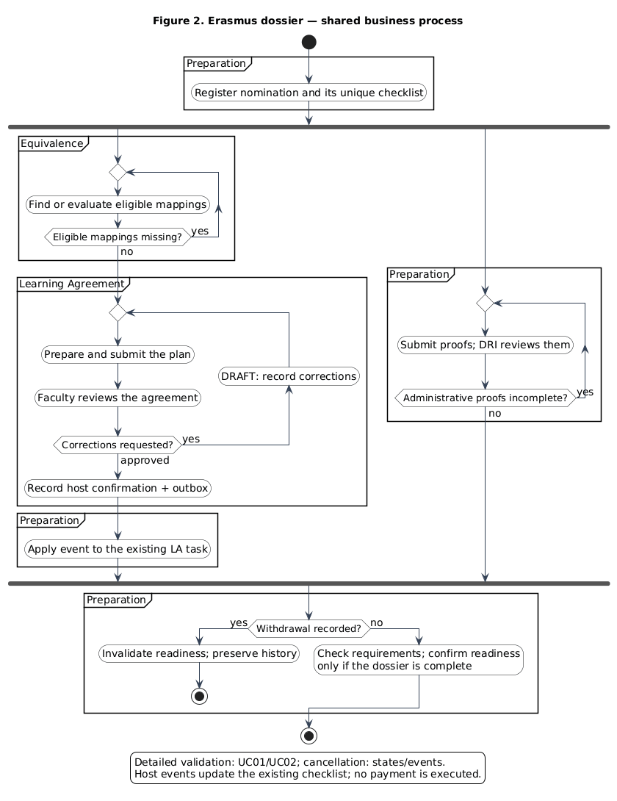

# Chapter 1. Definition and Structuring of Functional and Non-Functional Requirements

**Master in Software Development and Business Information Systems (SDBIS / SIA), 1st Year**  
**Course:** Object-Oriented Analysis and Design (OOAD)  
**Project:** Erasmus Mobility Platform (EMP): Enterprise Distributed Architecture for International Academic Exchanges  
**Authors:**
* Prigoreanu Alin-Gabriel (Student 1: Learning Agreement Management + 50% Mobility Preparation)
* Bîrgovan A. Mihai-Daniel (Student 2: Equivalence Management + 50% Mobility Preparation)

---

### Problem Statement and Academic Background

Within European higher education institutions participating in the Erasmus+ framework, student academic mobility is a strategic cornerstone of internationalization. However, managing exchange programs is plagued by operational fragmentation: workflows are mediated by disjointed email threads, manually scanned paper documents, out-of-date course catalogs, and a lack of real-time curricular synchronization between the sending institution (*Home University*) and the receiving institution (*Host University*).

The **Erasmus Mobility Platform (EMP)** is a focused academic and administrative prototype for preparing one semester study mobility after student nomination. It connects three responsibilities: course equivalence, Learning Agreement review, and preparation evidence. EWP exchange, scholarship payment, and production identity services are outside this project scope.

Following the principles of **Domain-Driven Design (DDD)**, the application's complexity is decomposed into three primary Bounded Contexts, supported by generic infrastructural subdomains:

---

### 1) Learning Agreement Management (Core Domain)

The **Learning Agreement Management** subdomain is the academic core. The Learning Agreement (LA) records the student's proposed host courses and their home-university recognition. This context protects explicit mappings, versioned drafts, credit rules, faculty review, and recorded host evidence.

The functional requirements grouped in this domain are:
* **Create and Initialize Learning Agreement (Create LA):** A nominated student creates a study contract linked to their unique mobility dossier (`MobilityId`, `StudentId`). Upon creation, the agreement enters the `DRAFT` state, encapsulating metadata regarding the host partner institution, academic year, target semester (Autumn, Spring, or Full Year), and mobility modality (Study vs. Traineeship).
* **Manage Course Lines (Manage Course Lines):** The student authors and mutates academic components partitioned into two strictly correlated tables:
  * **Table A (Study Programme at Receiving Institution):** Educational components to be completed abroad, capturing foreign course codes, official titles, semester term, language of instruction, and allocated ECTS credits.
  * **Table B (Recognition at Sending Institution):** Curricular courses from the home faculty degree plan that will be replaced and recognized upon successful completion of Table A.
* **Validate ECTS Credit Balance (Check ECTS Balance):** The aggregate enforces the core domain invariant: the cumulative credits earned in Table A must equal the recognized credits in Table B, strictly fulfilling the standard benchmark of **at least 30 ECTS credits per semester** (subject to bilateral agreement thresholds). This invariant check executes transactionally in memory prior to any submission attempt.
* **Propose New Academic Equivalences (Propose New Equivalence):** If a student discovers during study plan composition that a foreign course is missing from the institutional equivalence catalog, an extension flow (`<<extend>>`) is triggered, forwarding the syllabus and learning outcomes to the departmental teaching committee for expedited review.
* **Submit Learning Agreement (Submit LA):** The student submits the current draft. Each explicit 1:1 course mapping must be catalog-eligible for the mobility period, host and home credits must match, and the semester total must meet the project minimum of 30 ECTS. Success persists `SUBMITTED`; failure leaves the draft unchanged.
* **Home Academic Coordinator Review (Review LA):** The home faculty coordinator reviews curricular compatibility. The coordinator may approve the agreement, moving it to `APPROVED_BY_FACULTY`, or request corrections with a reason, returning it to `DRAFT`.
* **Host Partner Institutional Confirmation (Confirm LA at Host University):** After faculty approval, a DRI officer records evidence of host confirmation for that approved revision. The agreement transitions to `CONFIRMED_BY_HOST`; no EWP integration is implemented.
Amendments during the semester and scholarship disbursement are outside this prototype scope.
* **Contract Cancellation (Cancel LA):** Upon student withdrawal or force majeure, the agreement transitions to the terminal `CANCELLED` state, cascading closures through dependent subsystems.

---

### 2) Equivalence Management (Supporting Subdomain)

The **Equivalence Management** subdomain operates as a vital supporting catalog, maintaining a centralized repository of validated academic syllabus comparisons between the home faculty and international partner institutions. Its operational role is to relieve academic committees from redundantly evaluating identical syllabi each semester while providing students with pre-approved curricular paths prior to departure.

The functional requirements grouped in this domain are:
* **Search Course Equivalences (Search Equivalences):** Students and faculty query the active catalog using multi-criteria filters: partner university, country, degree program (BSc / MSc), field of study, and course codes.
* **Compare ECTS and Syllabi (Compare ECTS & Syllabus):** Side-by-side comparative inspection of course syllabi: instructional objectives, covered thematic units, learning outcomes, laboratory/project hours, and credit weights.
* **Register Institutional Equivalence (Register Equivalence):** Academic coordinators establish explicit 1:1 mappings between foreign courses and home degree subjects.
* **Validate ECTS Values (Validate ECTS Values):** The system enforces (`<<include>>`) that the credit allocation of mapped courses preserves academic credit parity without causing a graduation deficit.
* **Import Historical Curricular Mappings (Import Historical Equivalences):** Administrative bulk ingestion of legacy bilateral agreements and accredited equivalence matrices via structured CSV/JSON payloads (`<<extend>>`).
* **Approve Student Equivalence Proposals (Approve Proposed Equivalence):** Faculty evaluation of student-submitted syllabi, promoting vetted rules into the public institutional catalog.
* **Retire Outdated Equivalences (Retire Equivalence):** When either institution updates its degree curricula, obsolete equivalences transition to `RETIRED`, preserving historical validity for existing contracts while preventing future selection.

A proposal moves from `PROPOSED` to `UNDER_EVALUATION`. Evaluation and publication are one operation to `ACTIVE`; explicit rejection moves to `REJECTED`, and an active rule can later become `RETIRED`. The project score threshold is 80/100.

---

### 3) Mobility Preparation (Supporting Subdomain)

The **Mobility Preparation** subdomain governs administrative compliance, document onboarding, and logistical readiness between initial student nomination and physical departure abroad.

The functional requirements grouped in this domain are:
* **Confirm Student Nomination (Confirm Nomination):** International Relations Officers (DRI) log the official allocation of a student to a partner destination, initializing the mobility lifecycle.
* **Automated Checklist Generation (Generate Checklist):** Confirmation triggers (`<<include>>`) the generation of a customized collection of `ChecklistTask` entities derived from country- and cycle-specific templates. Standard onboarding tasks include:
  1. *Online Linguistic Support (OLS) language assessment;*
  2. *European Health Insurance Card (EHIC) or private international medical coverage;*
  3. *Student visa and residency documentation (for non-EU/EEA destinations);*
  4. *Erasmus+ Financial Grant Agreement signature;*
  5. *Recorded host confirmation for the Learning Agreement;*
  6. *Host institution formal acceptance letter and accommodation confirmation.*
* **Manage Checklist Templates (Manage Checklist Template):** Administrators define task templates, relative deadlines (e.g., *Departure Date minus 30 days*), and mandatory compliance criteria.
* **View Student Task Dashboard (View Checklist):** Real-time student progress tracking, displaying deadlines, instructions, and task states.
* **Deep-Link to Official Portals (Open Official Form):** Tasks linking to standardized external web applications (e.g., European Commission OLS portal or bank registration) offer contextual single-sign-on launch links (`<<extend>>`).
* **Upload Documents & Verify Submissions (Mark Task Done / Submit for Verification):** Students submit PDF certificates, transitioning tasks to `SUBMITTED_FOR_VERIFICATION`. DRI coordinators validate document authenticity, advancing tasks to `COMPLETED`.
* **Monitor Student Readiness Progress (Monitor Student Progress):** Coordinators oversee cohort onboarding metrics via progress percentages and bottleneck dashboards.
* **Flag Overdue Tasks (Flag Overdue Task):** The temporal background engine flags overdue items (`<<extend>>`), triggering administrative escalations.
* **Automated Deadline Notifications (Send Deadline Reminder):** Scheduled notifications dispatched at milestone intervals: T - 7 days, T - 3 days, and on the date of expiration.

The central aggregate `ChecklistTask` traverses the lifecycle: `INITIALIZED`, `PENDING_STUDENT_ACTION`, `SUBMITTED_FOR_VERIFICATION`, `COMPLETED`, and `OVERDUE`.

---

### 4) Generic Subdomains

* **Notification Service:** Decoupled asynchronous messaging subsystem for optional prototype notifications; delivery channels are outside the core transaction scope.
* **Security, Identity & Audit (GDPR):** Federated Single Sign-On (**eduGAIN / Institutional SSO**), Role-Based Access Control (**RBAC**), and an immutable, append-only cryptographic audit ledger tracking all personal data accesses and academic decisions.

---

### 5) End-to-End Transactional Architecture & Data Flow

The diagrams follow one semester mobility through three bounded contexts. T1–T5 are business transactions; only local writes are atomic. Academic and administrative preparation can proceed in parallel after nomination.

1. **T1 — Nomination:** DRI records the existing nomination. Preparation creates one checklist with four requirements per `MobilityId`.
2. **T2 — Equivalence:** The student searches the read-only catalog. If a mapping is missing, the coordinator evaluates a proposal: `UNDER_EVALUATION` → `ACTIVE` when score, equal credits, validity, rationale, and uniqueness rules pass; otherwise it remains under evaluation or is explicitly rejected.
3. **T3 — Agreement submission:** The student submits a versioned `DRAFT`. The system checks each 1:1 mapping, eligibility for the whole mobility period, equal credits, and the project minimum of 30 ECTS. Success commits `SUBMITTED`; a failed check leaves `DRAFT` unchanged.
4. **T4 — Host evidence:** The Home Academic Coordinator reviews the submitted agreement and may approve it or request corrections back to `DRAFT`. After faculty approval, DRI records host evidence. The agreement, decision, and outbox event commit in one local transaction. The event is delivered later and updates the existing academic checklist task idempotently.
5. **T5 — Readiness or cancellation:** The student submits administrative proofs and DRI reviews them. DRI confirms readiness only when all mandatory requirements are complete. A recorded withdrawal cancels the agreement and invalidates preparation; a stale event cannot reactivate it.
