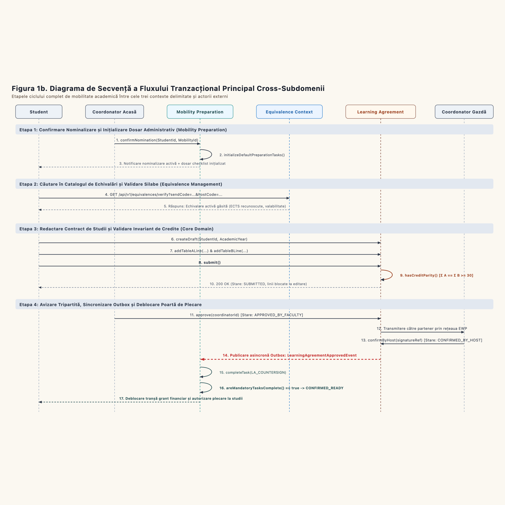

# Chapter 1. Definition and Structuring of Functional and Non-Functional Requirements

**Master in Software Development and Business Information Systems (SDBIS / SIA), 1st Year**  
**Course:** Object-Oriented Analysis and Design (OOAD)  
**Project:** Erasmus Mobility Platform (EMP): Enterprise Distributed Architecture for International Academic Exchanges  
**Authors:**
* Prigoreanu Alin-Gabriel (Student 1)
* Bîrgovan A. Mihai-Daniel (Student 2)
* Schipor Ana-Maria (Student 3)

---

### Problem Statement and Academic Background

Within European higher education institutions participating in the Erasmus+ framework, student academic mobility is a strategic cornerstone of internationalization. However, managing exchange programs is plagued by operational fragmentation: workflows are mediated by disjointed email threads, manually scanned paper documents, out-of-date course catalogs, and a lack of real-time curricular synchronization between the sending institution (*Home University*) and the receiving institution (*Host University*).

To eliminate administrative bottlenecks and achieve strict compliance with European Commission standards, specifically the **Erasmus Without Paper (EWP)** network, there is an urgent need to engineer an enterprise web application: the **Erasmus Mobility Platform (EMP)**. The platform orchestrates the complete mobility lifecycle: from student nomination confirmation and automated administrative onboarding checklists, to querying historic syllabus equivalence catalogs, authoring tripartite study contracts (*Learning Agreements*), validating European Credit Transfer and Accumulation System (ECTS) parity, and securing digital institutional approvals.

Following the principles of **Domain-Driven Design (DDD)**, the application's complexity is decomposed into three primary Bounded Contexts, supported by generic infrastructural subdomains:

---

### 1) Learning Agreement Management (Core Domain)

The **Learning Agreement Management** subdomain constitutes the core business engine and strategic differentiator of the enterprise platform. While managing administrative checklists or authentication represents generic or supporting operational tasks, the tripartite study contract (*Learning Agreement* - LA) represents the legal and academic foundation guaranteeing automatic credit recognition. This context encapsulates the platform's most rigorous business rules: multi-institution curricular parity, aggregate transaction integrity, and digital signature orchestration across three distinct stakeholders (Student, Home Academic Coordinator, and Host Institutional Coordinator).

The functional requirements grouped in this domain are:
* **Create and Initialize Learning Agreement (Create LA):** A nominated student creates a study contract linked to their unique mobility dossier (`MobilityId`, `StudentId`). Upon creation, the agreement enters the `DRAFT` state, encapsulating metadata regarding the host partner institution, academic year, target semester (Autumn, Spring, or Full Year), and mobility modality (Study vs. Traineeship).
* **Manage Course Lines (Manage Course Lines):** The student authors and mutates academic components partitioned into two strictly correlated tables:
  * **Table A (Study Programme at Receiving Institution):** Educational components to be completed abroad, capturing foreign course codes, official titles, semester term, language of instruction, and allocated ECTS credits.
  * **Table B (Recognition at Sending Institution):** Curricular courses from the home faculty degree plan that will be replaced and recognized upon successful completion of Table A.
* **Validate ECTS Credit Balance (Check ECTS Balance):** The aggregate enforces the core domain invariant: the cumulative credits earned in Table A must equal the recognized credits in Table B, strictly fulfilling the standard benchmark of **at least 30 ECTS credits per semester** (subject to bilateral agreement thresholds). This invariant check executes transactionally in memory prior to any submission attempt.
* **Propose New Academic Equivalences (Propose New Equivalence):** If a student discovers during study plan composition that a foreign course is missing from the institutional equivalence catalog, an extension flow (`<<extend>>`) is triggered, forwarding the syllabus and learning outcomes to the departmental teaching committee for expedited review.
* **Submit Learning Agreement (Submit LA):** The student formally submits the finalized study plan for departmental review. This command mandatorily includes the automated ECTS balance validation (`<<include>>`). Upon success, the aggregate transitions to `SUBMITTED`, locking the course lines from uncoordinated student edits.
* **Home Academic Coordinator Review (Review LA):** The home faculty coordinator reviews curricular compatibility. The coordinator may:
  * **Approve the agreement:** Transitioning the contract to `APPROVED_BY_FACULTY`.
  * **Request changes (Request Amendment):** Transitioning the contract to `UNDER_REVIEW`, returning it to the student accompanied by contextual audit notes identifying incompatible courses.
  * **Notify student of decision (Notify Student of Decision):** Every state transition automatically publishes an in-app and email alert (`<<include>>`).
* **Escalate Overdue Academic Reviews (Escalate Overdue Review):** A background temporal scheduler monitors agreements resting in the `SUBMITTED` state. If the designated coordinator fails to render a decision within **5 business days**, the scheduler triggers an automated escalation notification to the Vice-Dean for International Relations (`<<extend>>`).
* **Host Partner Institutional Confirmation (Confirm LA at Host University):** Following home faculty endorsement, the contract is transmitted securely across the European network via the EWP REST API. Upon digital signature by the host coordinator, the agreement achieves full tripartite validity and transitions to `CONFIRMED_BY_HOST`.
* **In-Mobility Exceptional Amendments (Request Amendment):** During the initial weeks of mobility, if courses at the host university are cancelled or rescheduled, the student can initiate an amendment request (`AMENDED` state), triggering an isolated tripartite approval cycle for altered lines only.
* **Contract Cancellation (Cancel LA):** Upon student withdrawal or force majeure, the agreement transitions to the terminal `CANCELLED` state, cascading closures through dependent subsystems.

---

### 2) Equivalence Management (Supporting Subdomain)

The **Equivalence Management** subdomain operates as a vital supporting catalog, maintaining a centralized repository of validated academic syllabus comparisons between the home faculty and international partner institutions. Its operational role is to relieve academic committees from redundantly evaluating identical syllabi each semester while providing students with pre-approved curricular paths prior to departure.

The functional requirements grouped in this domain are:
* **Search Course Equivalences (Search Equivalences):** Students and faculty query the active catalog using multi-criteria filters: partner university, country, degree program (BSc / MSc), field of study, and course codes.
* **Compare ECTS and Syllabi (Compare ECTS & Syllabus):** Side-by-side comparative inspection of course syllabi: instructional objectives, covered thematic units, learning outcomes, laboratory/project hours, and credit weights.
* **Register Institutional Equivalence (Register Equivalence):** Academic coordinators establish canonical 1:1 or N:M mappings between foreign courses and home degree subjects.
* **Validate ECTS Values (Validate ECTS Values):** The system enforces (`<<include>>`) that the credit allocation of mapped courses preserves academic credit parity without causing a graduation deficit.
* **Import Historical Curricular Mappings (Import Historical Equivalences):** Administrative bulk ingestion of legacy bilateral agreements and accredited equivalence matrices via structured CSV/JSON payloads (`<<extend>>`).
* **Approve Student Equivalence Proposals (Approve Proposed Equivalence):** Faculty evaluation of student-submitted syllabi, promoting vetted rules into the public institutional catalog.
* **Retire Outdated Equivalences (Retire Equivalence):** When either institution updates its degree curricula, obsolete equivalences transition to `RETIRED`, preserving historical validity for existing contracts while preventing future selection.

The central entity `AcademicEquivalence` traverses the lifecycle states: `PROPOSED`, `UNDER_EVALUATION`, `APPROVED`, `ACTIVE`, and `RETIRED`.

---

### 3) Mobility Preparation (Supporting Subdomain)

The **Mobility Preparation** subdomain governs administrative compliance, document onboarding, and logistical readiness between initial student nomination and physical departure abroad.

The functional requirements grouped in this domain are:
* **Confirm Student Nomination (Confirm Nomination):** International Relations Officers (DRI) log the official allocation of a student to a partner destination, initializing the mobility lifecycle.
* **Automated Checklist Generation (Generate Checklist):** Confirmation triggers (`<<include>>`) the generation of a customized collection of `ChecklistTask` entities derived from country- and cycle-specific templates. Standard onboarding tasks include:
  1. *Online Linguistic Support (OLS) language assessment;*
  2. *European Health Insurance Card (EHIC) or private international medical coverage;*
  3. *Student visa and residency documentation (for non-EU/EEA destinations);*
  4. *Erasmus+ Financial Grant Agreement signature;*
  5. *Final tripartite signature of the Learning Agreement;*
  6. *Host institution formal acceptance letter and accommodation confirmation.*
* **Manage Checklist Templates (Manage Checklist Template):** Administrators define task templates, relative deadlines (e.g., *Departure Date minus 30 days*), and mandatory compliance criteria.
* **View Student Task Dashboard (View Checklist):** Real-time student progress tracking, displaying deadlines, instructions, and task states.
* **Deep-Link to Official Portals (Open Official Form):** Tasks linking to standardized external web applications (e.g., European Commission OLS portal or bank registration) offer contextual single-sign-on launch links (`<<extend>>`).
* **Upload Documents & Verify Submissions (Mark Task Done / Submit for Verification):** Students submit PDF certificates, transitioning tasks to `SUBMITTED_FOR_VERIFICATION`. DRI coordinators validate document authenticity, advancing tasks to `COMPLETED`.
* **Monitor Student Readiness Progress (Monitor Student Progress):** Coordinators oversee cohort onboarding metrics via progress percentages and bottleneck dashboards.
* **Flag Overdue Tasks (Flag Overdue Task):** The temporal background engine flags overdue items (`<<extend>>`), triggering administrative escalations.
* **Automated Deadline Notifications (Send Deadline Reminder):** Scheduled notifications dispatched at milestone intervals: T - 7 days, T - 3 days, and on the date of expiration.

The central aggregate `ChecklistTask` traverses the lifecycle: `INITIALIZED`, `PENDING_STUDENT_ACTION`, `SUBMITTED_FOR_VERIFICATION`, `COMPLETED`, and `OVERDUE`.

---

### 4) Generic Subdomains

* **Notification Service:** Decoupled asynchronous messaging subsystem dispatching transaction alerts across email, push notifications, and EWP webhook integrations.
* **Security, Identity & Audit (GDPR):** Federated Single Sign-On (**eduGAIN / Institutional SSO**), Role-Based Access Control (**RBAC**), and an immutable, append-only cryptographic audit ledger tracking all personal data accesses and academic decisions.

---

### 5) End-to-End Transactional Architecture & Data Flow

Data flows across Bounded Context boundaries through five coordinated transactional stages:

#### Detailed Transaction Breakdown:

1. **Transaction T1: Nomination & Automated Onboarding Checklist (Mobility Preparation)**
   * **Trigger:** Institutional selection committee allocates a mobility grant.
   * **Data Flow:** The coordinator invokes `Confirm Nomination`, providing `StudentId`, `MobilityId`, destination host, and term.
   * **Consistency:** An ACID transaction instantiates the mobility dossier and populates the personalized `ChecklistTask` entities. The domain event `StudentNominatedEvent` is emitted.

2. **Transaction T2: Equivalence Discovery & Catalog Enrichment (Equivalence Management)**
   * **Trigger:** The student identifies courses at the partner institution.
   * **Data Flow:** A synchronous REST query (`Search Equivalences`) returns accredited mappings and credit values.
   * **Exception Branch:** If a syllabus is missing, the student invokes `Propose New Equivalence`. The coordinator approves the syllabus, promoting it to `ACTIVE` for institutional reuse.

3. **Transaction T3: Study Plan Authoring & Invariant Enforcement (Learning Agreement)**
   * **Trigger:** Student composes Table A and Table B.
   * **Data Flow:** `Create LA` instantiates the `LearningAgreement` aggregate in the `DRAFT` state. The student maps foreign course lines to domestic degree subjects.
   * **Invariant Check:** Invoking `Submit LA` triggers internal aggregate validation (`Check ECTS Balance`). The transaction enforces $\sum ECTS(Table A) = \sum ECTS(Table B) \ge 30$. Non-compliant attempts are rejected with zero database mutation. Compliant contracts transition to `SUBMITTED`.

4. **Transaction T4: Tripartite Digital Review & Outbox Event Synchronization (Integrations)**
   * **Trigger:** Home coordinator executes `Review LA`.
   * **Data Flow:** If approved, the contract advances to `APPROVED_BY_FACULTY` and is transmitted across the European EWP network. Upon partner endorsement, the contract becomes `CONFIRMED_BY_HOST`.
   * **Outbox Pattern:** State persistence writes `LearningAgreementApprovedEvent` to the local transactional `Outbox` table. An asynchronous message broker guarantees at-least-once delivery to **Mobility Preparation**, which idempotently marks the checklist task as `COMPLETED`.

5. **Transaction T5: Exceptional Amendments & Force Majeure Abort (Interruptible Region)**
   * **In-Mobility Amendments:** If foreign courses are cancelled, `Request Amendment` transitions the contract to `AMENDED` for an isolated tripartite delta approval.
   * **Mobility Cancellation:** In the event of force majeure, the cancellation signal traverses the `«interrupting edge»` of the `InterruptibleActivityRegion`. This cancels the `LearningAgreement` (`CANCELLED`), marks active checklist tasks as `OVERDUE`/`ABORTED`, and deallocates reserved Erasmus scholarship funds.
