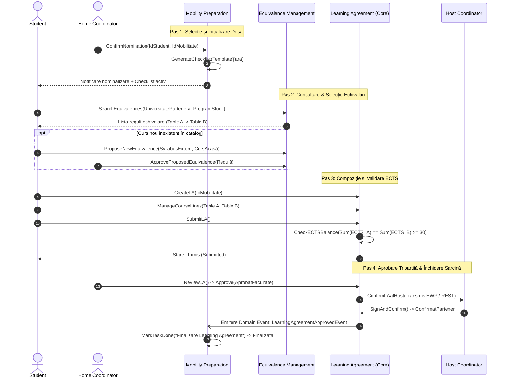

# Capitolul 1. Definirea și Structurarea Cerințelor Funcționale și Non-Funcționale ale Aplicației

**Master SIA / SDBIS, Anul I, Zi**  
**Disciplina:** Analiza și Proiectarea Orientate Obiect (Object-Oriented Analysis and Design)  
**Proiect:** Erasmus Mobility Platform (EMP) — Sistem Integrat pentru Gestiunea Mobilităților Academice Internaționale  

---

## 1.1 Scurtă descriere a contextului și a principalelor cerințe ale aplicației

În cadrul instituțiilor de învățământ superior (universități partenere în rețeaua europeană Erasmus+), mobilitățile academice pentru studenți reprezintă un pilon strategic fundamental. În prezent, desfășurarea acestor mobilități se confruntă cu o fragmentare severă: fluxurile de aprobare sunt intermediate de zeci de e-mailuri nestructurate, documente PDF semnate olograf și scanate repetat, cataloage de cursuri neactualizate și lipsa unei sincronizări în timp real între cerințele curriculare ale universității de origine (*Home University*) și oferta universității gazdă (*Host University*).

Pentru eliminarea blocajelor birocratice și alinierea la standardele europene **Erasmus Without Paper (EWP)**, este necesară dezvoltarea unei platforme web integrate — **Erasmus Mobility Platform (EMP)**. Această aplicație gestionează întregul ciclu de viață al unei mobilități: de la confirmarea nominalizării și completarea listei administrative de verificare, până la consultarea catalogului istoric de echivalări, elaborarea contractului de studii (*Learning Agreement*), validarea echilibrului de credite transferabile (ECTS) și aprobarea tripartită a acestuia.

Conform metodologiei **Domain-Driven Design (DDD)**, complexitatea funcțională a aplicației este descompusă în trei subdomenii principale, completate de subdomenii generice de suport tehnic:

---

### 1) Learning Agreement Management (Core Domain)

Subdomeniul **Learning Agreement Management** reprezintă nucleul valoric (*Core Domain*) și diferențiatorul strategic al platformei. Dacă gestiunea documentelor administrative sau a utilizatorilor reprezintă funcționalități auxiliare standard, contractul educațional tripartit (*Learning Agreement* - LA) constituie fundamentul juridic și academic al recunoașterii studiilor internaționale. Acest domeniu concentrează logica de afaceri critică: respectarea strictă a parității curriculare, integritatea agregatului de contract și orchestrarea semnăturilor digitale între trei părți distincte (Student, Coordonator Academic Facultate de Origine, Coordonator Universitate Gazdă).

Cerințele funcționale grupate în acest domeniu sunt:
* **Crearea și inițializarea contractului de studii (Create LA):** Un student nominalizat creează un nou contract de studii asociat mobilității sale (`IdMobilitate`, `IdStudent`). La inițializare, contractul primește automat starea `Ciorna` (*Draft*) și încapsulează metadatele universității partenere, anul academic, semestrul de mobilitate (Semestrul 1, Semestrul 2 sau An Întreg) și tipul programului de mobilitate (Studiu / Plasament).
* **Gestiunea liniilor curriculare (Manage Course Lines):** Studentul adaugă, editează sau elimină componente educaționale organizate canonic în două secțiuni corelate:
  * *Table A (Study Programme at the Receiving Institution):* materiile pe care studentul se angajează să le frecventeze la universitatea gazdă (cod curs, denumire oficială, semestru, limbă de predare și număr credite ECTS).
  * *Table B (Recognition at the Sending Institution):* materiile din planul de învățământ al facultății de origine care vor fi echivalate la întoarcere (cod curs intern, denumire disciplină UAIC, semestru și număr credite ECTS).
* **Verificarea echilibrului de credite (Check ECTS Balance):** Sistemul aplică invariantul de domeniu conform căruia suma creditelor din Table A trebuie să acopere volumul de muncă recunoscut în Table B. Pentru un semestru complet de studii, platforma validează atingerea pragului normat de **30 de credite ECTS** (cu o marjă contractuală configurabilă per acord bilateral). Această verificare este executată tranzacțional înainte de orice tentativă de trimitere.
* **Propunerea de echivalări noi (Propose New Equivalence):** Dacă în momentul compunerii liniilor de curs studentul constată că o disciplină de la universitatea gazdă nu figurează în catalogul oficial de echivalări, acesta declanșează un flux de extindere (`<<extend>>`), transmițând fișa disciplinei (*syllabus*) comisiei didactice pentru evaluare preliminară.
* **Depunerea oficială a contractului (Submit LA):** La finalizarea editării, studentul transmite contractul spre avizare. Operațiunea include obligatoriu verificarea automată a balanței ECTS (`<<include>>`). În caz de succes, starea contractului devine `Trimis` (*Submitted*), iar drepturile de editare ale studentului asupra liniilor de curs sunt blocate.
* **Revizuirea academică de către Coordonatorul Academic (Review LA):** Coordonatorul de facultate analizează compatibilitatea conținutului disciplinelor propuse. În urma revizuirii, acesta poate:
  * *Aproba contractul:* contractul tranzitează în starea `AprobatFacultate`.
  * *Solicita modificări (Request Amendment):* contractul tranzitează în starea `InRevizuire`, fiind returnat studentului însoțit de observații punctuale și sugestii de înlocuire a cursurilor incompatibile.
  * *Notifica automat studentul (Notify Student of Decision):* orice decizie generează o notificare de sistem și un e-mail informativ (`<<include>>`).
* **Escaladarea revizuirilor restante (Escalate Overdue Review):** Un serviciu automat de temporizare (*Scheduler*) monitorizează contractele aflate în starea `Trimis`. Dacă coordonatorul academic nu emite o decizie în termen de **5 zile lucrătoare**, sistemul declanșează automat o notificare de escaladare către prodecanul responsabil cu relațiile internaționale (`<<extend>>`).
* **Confirmarea de către Universitatea Gazdă (Confirm LA at Host University):** După avizarea de către facultatea de origine, contractul este transmis securizat prin rețeaua europeană (sau prin acces securizat) coordonatorului extern. La validarea și semnarea digitală de către partener, contractul devine executoriu și tranzitează în starea `ConfirmatPartener`.
* **Amendarea contractului în perioada mobilității (Request Amendment):** În primele săptămâni de la sosirea la universitatea parteneră, dacă anumite cursuri se suprapun orar sau nu mai sunt predate, studentul poate genera o cerere de amendament, activând starea `Amendat`. Se reia ciclul restrâns de aprobare doar pentru materiile adăugate/șterse.
* **Anularea contractului (Cancel LA):** În cazul renunțării la mobilitate sau al intervenirii unei situații de forță majoră, contractul este trecut în starea terminală `Anulat`, declanșând cascada de închidere a dosarului.

---

### 2) Equivalence Management (Supporting Subdomain)

Subdomeniul **Equivalence Management** funcționează ca un domeniu de suport (*Supporting Subdomain*), oferind un catalog consolidat de cunoștințe academice acumulate istoric între facultatea de origine și instituțiile de învățământ partenere din spațiul european. Rolul său operațional este de a degreva comisiile didactice de reevaluarea redundantă a aceluiași syllabus an de an și de a oferi studenților certitudinea recunoașterii automate a creditelor înainte de a pleca în mobilitate.

Cerințele funcționale grupate în acest domeniu sunt:
* **Căutarea în catalogul de echivalări (Search Equivalences):** Studenții și coordonatorii pot interoga rapid baza de date a echivalărilor active folosind filtre combinate: universitate parteneră, țară de destinație, program de studii (Licență / Master), domeniu (ex: Informatică Economică, Cibernetică) și cod disciplină.
* **Compararea creditelor ECTS și a fișelor disciplinelor (Compare ECTS & Syllabus):** Sistemul permite vizualizarea în oglindă a fișei disciplinei de acasă și a programei de la universitatea parteneră (obiective, conținut tematic, competențe dobândite, număr de ore de laborator/proiect și credite ECTS alocate).
* **Înregistrarea oficială a unei echivalări (Register Equivalence):** Coordonatorul academic sau comisia de echivalare înregistrează o relație canonică între una sau mai multe materii din universitatea gazdă și disciplina corespondentă din planul local. Relația poate fi 1:1 sau agregată (N:M).
* **Validarea creditelor ECTS (Validate ECTS Values):** La înregistrarea oricărei reguli de echivalare, sistemul validează obligatoriu (`<<include>>`) că suma creditelor acordate disciplinelor echivalente nu creează deficit de credite transferabile față de programa națională.
* **Importul masiv de echivalări istorice (Import Historical Equivalences):** Permite administratorilor sau coordonatorilor încărcarea în masă a acordurilor curriculare bilaterale și a matricelor de echivalare din anii universitari anteriori dintr-un format structurat (CSV / JSON), extinzând procesul standard de înregistrare (`<<extend>>`).
* **Aprobarea propunerilor de echivalare noi (Approve Proposed Equivalence):** Coordonatorul academic analizează dosarele de solicitare transmise de studenți pentru cursuri noi, atașează decizia consiliului departamental și aprobă promovarea regulii în catalogul general.
* **Retragerea sau arhivarea unei echivalări (Retire Equivalence):** În cazul modificării planului de învățământ local sau al schimbării curriculei universității partenere, echivalarea devine `Retrasa`, nemaifiind disponibilă pentru mobilități viitoare, fără a afecta însă contractele aprobate anterior.

Entitatea centrală `AcademicEquivalence` parcurge ciclul de viață definit de stările: `Propusa`, `InEvaluare`, `Aprobata`, `Activa`, `Retrasa`.

---

### 3) Mobility Preparation (Supporting Subdomain)

Subdomeniul **Mobility Preparation** este un domeniu de suport administrativ (*Supporting Subdomain*) dedicat gestionării conformității procedurale și trasabilității logistice a studentului între momentul în care a fost declarat admis la selecția Erasmus și data plecării efective în străinătate. Acest modul asigură respectarea termenelor limită (*deadlines*) pentru depunerea documentelor legale, medicale și financiare.

Cerințele funcționale grupate în acest domeniu sunt:
* **Confirmarea nominalizării studentului (Confirm Nomination):** Coordonatorul de relații internaționale (sau coordonatorul academic) introduce confirmarea selecției studentului pentru universitatea parteneră alocată. Această acțiune marchează începutul etapei operaționale de pregătire a mobilității.
* **Generarea automată a listei de verificare (Generate Checklist):** La confirmarea nominalizării, sistemul generează automat (`<<include>>`) o colecție personalizată de sarcini de pregătire (`ChecklistTask`), instanțiată pe baza șablonului specific țării de destinație și ciclului de studii. Printre sarcinile standard generate se numără:
  1. *Testare lingvistică OLS (Online Linguistic Support);*
  2. *Cardul European de Asigurări Sociale de Sănătate (EHIC) / Asigurare medicală privată;*
  3. *Obținere viză de studii / Permis de ședere (pentru țări din afara UE/SEE);*
  4. *Semnare Contract Financiar de Grant Erasmus;*
  5. *Aprobare și semnare finală Learning Agreement;*
  6. *Confirmare cazare / Scrisoare de acceptare oficială de la partener.*
* **Gestiunea șabloanelor de verificare (Manage Checklist Template):** Coordonatorii pot defini și ajusta șabloane de sarcini: adăugare de cerințe specifice (ex: certificat de vaccinare, scrisoare de cazare), stabilire date limită relative (ex: *T - 30 zile până la începerea mobilității*) și configurare nivel de criticitate.
* **Vizualizarea listei de sarcini (View Checklist):** Studentul accesează panoul de bord personalizat, unde vizualizează stadiul fiecărei sarcini, termenele scadenței și instrucțiunile detaliate de rezolvare.
* **Deschiderea formularelor oficiale asociate (Open Official Form):** Pentru sarcinile care necesită completarea unor cereri standardizate (ex: contract financiar tipizat sau platforma OLS), sistemul pune la dispoziție o legătură directă securizată către resursa respectivă (`<<extend>>`).
* **Încărcarea documentelor și finalizarea sarcinilor (Mark Task Done / Submit for Verification):** Studentul încarcă dovada solicitată (PDF scanat, certificat) și marchează sarcina drept trimisă spre verificare. Coordonatorul validează conformitatea documentului, iar sarcina trece în starea `Finalizata`.
* **Monitorizarea progresului mobilității (Monitor Student Progress):** Coordonatorul vizualizează în timp real gradul de completare al dosarului fiecărui student (procentaj de îndeplinire, sarcini blocate, alerte de întârziere).
* **Semnalarea automată a sarcinilor restante (Flag Overdue Task):** Dacă data curentă depășește scadența setată pentru o sarcină nefinalizată, sistemul declanșează o marcare de depășire (`<<extend>>`), alertând atât studentul, cât și coordonatorul.
* **Trimiterea de notificări automate de scadență (Send Deadline Reminder):** Un serviciu automat de fundal (*Scheduler*) scanează periodic termenele limită și trimite notificări push/email la praguri cheie: cu 7 zile înainte de scadență, cu 3 zile înainte și la depășirea termenului.

Entitatea centrală `ChecklistTask` are ciclul de viață delimitat de stările: `Initializata`, `InAsteptareDocument`, `TrimisaSpreValidare`, `Finalizata`, `Depasita`.

---

### 4) Subdomenii Generice (Generic Subdomains)

Pentru a susține funcționarea integrată fără a polua logica de domeniu specifică, arhitectura se bazează pe două subdomenii generice reutilizabile:
* **Notification Service:** Asigură dispecerizarea asincronă a alertelor către actori prin canale multiple: e-mail tranzacțional (notificări de depunere, aprobare, returnare spre revizuire, depășire termen), notificări de tip push/in-app și evenimente de integrare către rețeaua internațională (EWP connectors).
* **Security, Identity & Audit (GDPR):** Furnizează mecanismele de autentificare unică federată (**eduGAIN / SSO UAIC**), controlul accesului bazat pe roluri (**RBAC**: *Student*, *Coordonator Academic*, *Coordonator Relații Internaționale*, *Administrator Partener Extern*) și jurnalizarea imuabilă (*append-only audit log*) a tuturor operațiunilor ce implică date cu caracter personal și decizii academice.

---

## 1.2 Descrierea Tranzacțiilor Principale și a Fluxului de Date

Funcționarea coerentă a platformei Erasmus Mobility Platform presupune o orchestrare tranzacțională precisă între Bounded Context-urile identificate. Datele circulă structurat pe parcursul celor cinci etape tranzacționale majore:

### Detalierea fluxului tranzacțional pas cu pas:

1. **Tranzacția T1: Selecție, Nominalizare și Inițializare Checklist (Mobility Preparation)**
   * *Declanșator:* Comisia de selecție a facultății validează dosarele de concurs și alocă studentului o mobilitate la o universitate parteneră.
   * *Circulația datelor:* Coordonatorul apelează `Confirm Nomination`, furnizând `IdStudent`, `IdMobilitate`, universitatea destinație și semestrul aprobat. 
   * *Consistență:* În cadrul aceleiași tranzacții de bază de date, sistemul instanțiază dosarul de pregătire și generează lista personalizată de sarcini (`ChecklistTask`) preluată din șablonul asociat țării partenere. Se emite evenimentul `NominalizareConfirmataEvent`, iar studentul este notificat să acceseze platforma.

2. **Tranzacția T2: Consultarea și Alimentarea Catalogului de Echivalări (Equivalence Management)**
   * *Declanșator:* Studentul dorește să identifice disciplinele pe care le va studia în străinătate și corespondența acestora cu materiile din planul de învățământ de acasă.
   * *Circulația datelor:* Studentul trimite o interogare sincronă REST către subdomeniul de echivalări (`Search Equivalences`). Serviciul returnează setul de materii recunoscute istoric, împreună cu fișele disciplinelor și creditele ECTS aferente.
   * *Ramură de excepție:* Dacă o disciplină dorită de la partener nu figurează în catalog, studentul declanșează `Propose New Equivalence`, încărcând programa analitică. Tranzacția creează o entitate `AcademicEquivalence` în starea `Propusa`. Coordonatorul evaluează propunerea și, prin tranzacția `Approve Proposed Equivalence`, o promovează în starea `Activa`, devenind reutilizabilă pentru întreaga facultate.

3. **Tranzacția T3: Compunerea, Validarea ECTS și Depunerea Contractului (Learning Agreement - Core Domain)**
   * *Declanșator:* Studentul asociază cursurile identificate în planul său de studii.
   * *Circulația datelor:* Prin comanda `Create LA`, se inițializează agregatul `LearningAgreement` în starea `Ciorna`. Studentul populează liniile din Table A (cursuri gazdă) și Table B (cursuri echivalente acasă).
   * *Garantarea invariantului:* La executarea comenzii `Submit LA`, agregatul execută metoda de validare internă a echilibrului de credite (`Check ECTS Balance`). Tranzacția verifică că $\sum ECTS(Table A) = \sum ECTS(Table B) \ge 30$ credite. Dacă invariantul este încălcat, tranzacția este refuzată (*rollback*) și studentul primește un mesaj de eroare explicit. Dacă validarea reușește, contractul tranzitează în starea `Trimis`.

4. **Tranzacția T4: Aprobarea Tripartită și Sincronizarea Asincronă cu Checklist-ul (Integrations & Outbox)**
   * *Declanșator:* Coordonatorul academic analizează contractul trimis (`Review LA`).
   * *Circulația datelor:* 
     * Dacă coordonatorul solicită rectificări, contractul trece în `InRevizuire`, iar studentul este notificat pentru ajustarea liniilor de curs.
     * Dacă este conform, coordonatorul aplică semnătura instituțională, iar contractul devine `AprobatFacultate`.
     * Contractul este expediat automat către coordonatorul universității gazdă (`Confirm LA at Host University`), fie prin rețeaua Erasmus Without Paper (EWP API), fie prin acces extern dedicat.
     * La semnarea de către partener, contractul atinge starea finală valabilă `ConfirmatPartener`.
   * *Propagarea evenimentelor:* Trecerea în starea `ConfirmatPartener` persistă în tabela `Outbox` evenimentul de domeniu `LearningAgreementApprovedEvent`. Serviciul de mesagerie publică evenimentul către broker, de unde subdomeniul **Mobility Preparation** consumă mesajul în mod idempotent și actualizează automat starea sarcinii „Finalizare & Semnare Learning Agreement” din checklist în starea `Finalizata`.

5. **Tranzacția T5: Modificări Excepționale și Întreruperea Mobilității (Interruptible Region)**
   * *Amendamente:* Dacă după începerea semestrului o materie este anulată la universitatea gazdă, studentul apelează `Request Amendment`. Contractul trece în starea `Amendat`, permițând crearea unei secțiuni de modificare (*Changes to Table A / Table B*) care parcurge un circuit simplificat de aprobare tripartită.
   * *Anulare mobilitate (Forță Majoră / Renunțare):* Dacă studentul renunță la mobilitate, coordonatorul inițiază comanda de anulare. În diagrama de activitate, această tranziție este modelată printr-o muchie de tip întrerupere (*Interrupting Edge* / fulger) ce părăsește regiunea de activitate întreruptibilă (*InterruptibleActivityRegion*). Această tranzacție cascadează atomic starea contractului `LearningAgreement` în `Anulat` și marchează toate sarcinile active din `ChecklistTask` drept anulate/închise, eliberând fondurile de grant alocate.

---

## 1.3 Tabelul Cerințelor Non-Funcționale Măsurabile (Matricea NFR cu SLA)

În conformitate cu standardele de inginerie software și cerințele cursului de Analiză și Proiectare Orientată Obiect, cerințele non-funcționale definesc constrângerile arhitecturale, atributele de calitate și nivelurile de serviciu garantate (*Service Level Agreement* - SLA). 

Fiecare cerință este formulată strict pe baza unui **prag măsurabil, a unei unități de măsură și a unei condiții explicite de verificare**, excluzând formulările vagi sau dezideratele calitative subiective.

### Tabelul 1.1. Matricea Cerințelor Non-Funcționale Măsurabile (SLA & Criterii de Acceptare)

| Categorie Arhitecturală | Cerință Non-Funcțională Măsurabilă | Criteriu de Acceptare (SLA / Verificare Cuantificabilă) | Impact Arhitectural Direct (DDD & Tehnologie) |
| :--- | :--- | :--- | :--- |
| **Performanță & Timp de Răspuns** | **Timpul de răspuns la căutarea echivalărilor în catalog** | Latența la nivelul percentilului **p95 < 250 ms** (și p99 < 500 ms) pentru căutări multi-criteriale (filtrare după universitate, țară, cod disciplină) la o sarcină de 100 interogări concurente, pe un catalog conținând cel puțin 50.000 de înregistrări de materii. | Indexare compusă B-Tree pe `(universitate_id, cod_disciplina)` în PostgreSQL; mecanism de caching de nivel 2 (Redis / Hibernate L2 Cache) pentru cataloagele partenere active. |
| **Performanță & Integritate Date** | **Latența la validarea creditelor ECTS și a echilibrului curricular** | Latență **< 100 ms** la apelul operației `Submit LA` pentru validarea invariantului de paritate ($\sum Table A = \sum Table B \ge 30$ credite) pe contracte conținând până la 30 linii de curs. | Validare pură în memorie la nivelul Agregatului de Domeniu (`LearningAgreement.validateEctsBalance()`), fără interogări suplimentare de rețea. |
| **Securitate, Conformitate & Audit** | **Jurnalizarea imuabilă de audit (GDPR și Decizii Academice)** | **100% din operațiunile de modificare**, aprobare sau respingere a contractelor educaționale, precum și accesul la date personale (PII - CNP, cont bancar, note), generează o intrare de audit imuabilă persistată sincron în **< 20 ms**. | Tabela dedicată de audit cu chei criptografice de legătură (HMAC SHA-256 / Append-Only Ledger), segregare la nivel de roluri (Spring Security RBAC + JPA Auditing). |
| **Scalabilitate & Procesare Asincronă** | **Procesarea batch a sarcinilor și trimiterea reminderelor de scadență** | Serviciul de fundal (*Scheduler*) trebuie să scaneze zilnic cel puțin **10.000 de dosare active de mobilitate**, să identifice sarcinile restante și să dispaceze alertele de notificare în **mai puțin de 60 de secunde**. | Arhitectură asincronă cu procesare paralelizată pe loturi (Spring Batch / Virtual Threads JDK 23), cozi dedicate de mesagerie (RabbitMQ / Kafka). |
| **Consistență Tranzacțională** | **Consistența atomică la anularea mobilității (Interruptible Region)** | Trecerea mobilității în starea `Anulat` provoacă tranziția în cascadă a contractului `LearningAgreement` și a tuturor celor `N` sarcini asociate din checklist în starea `Anulat` în cadrul aceleiași tranzacții ACID locale sau în **< 1.500 ms** prin propagare de evenimente asincrone via Outbox. | Mecanismul **Transactional Outbox**: persistența stării agregatului și a evenimentului `MobilityCancelledEvent` în aceeași tranzacție locală DB, urmată de consum idempotent în celelalte contexte. |
| **Disponibilitate & Reziliență** | **Disponibilitatea platformei în perioadele de vârf de selecție** | Rata de disponibilitate a sistemului (*Uptime*) de **minimum 99.5%** în perioadele critice de semnare a contractelor de studii (lunile Septembrie–Octombrie și Ianuarie–Februarie), cu un timp mediu de recuperare (**MTTR < 15 minute**). | Desfășurare containerizată multi-instanță (Docker / Kubernetes), health-checks automate (`/actuator/health`), failover automat pentru nodurile de bază de date. |

---

## 1.4 Descompunerea Strategică DDD și Context Mapping

În baza analizei funcționale și a constrângerilor de afaceri, arhitectura de ansamblu este organizată sub forma a trei Bounded Context-uri principale integrate prin contracte explicite.

### Tabelul 1.2. Glosarul Termenilor Ubiquitous Language

| Termen de Afaceri / Concept | Bounded Context (Subdomeniu) | Definiție de Afaceri și Rol Operațional |
| :--- | :--- | :--- |
| **Learning Agreement (LA)** | *Learning Agreement Management* (Core Domain) | Agregatul central care reprezintă contractul educațional tripartit dintre student, universitatea de origine și universitatea primitoare, garantând recunoașterea academică prealabilă a creditelor. |
| **Table A** | *Learning Agreement Management* (Core Domain) | Colecția de materii pe care studentul se angajează să le urmeze la universitatea gazdă, incluzând denumirile, codurile internaționale și numărul de credite ECTS corespunzător. |
| **Table B** | *Learning Agreement Management* (Core Domain) | Colecția de discipline din planul de învățământ al facultății de origine care vor fi înlocuite/echivalate la promovarea materiilor din Table A. |
| **ECTS (European Credit Transfer System)** | *Shared Kernel* (Value Object comun) | Unitatea standard de măsură a volumului academic de muncă; un semestru universitar normat echivalează cu un etalon fix de 30 de credite ECTS. |
| **Academic Equivalence (Echivalare)** | *Equivalence Management* (Supporting Subdomain) | Regula instituțională formală care stabilește că una sau mai multe materii de la un partener extern au competențe și conținut compatibil cu o disciplină din programa locală. |
| **Syllabus (Programă Analitică)** | *Equivalence Management* (Supporting Subdomain) | Descrierea curriculară oficială a cursului: obiective didactice, competențe transmise, capitole tematice, bibliografie și sistem de notare. |
| **Nominalizare (Nomination)** | *Mobility Preparation* (Supporting Subdomain) | Actul administrativ prin care facultatea de origine confirmă selecția oficială a unui student pentru a ocupa un loc de mobilitate la un partener academic specificat. |
| **Sarcina Checklist (ChecklistTask)** | *Mobility Preparation* (Supporting Subdomain) | Unitate indivizibilă de conformitate administrativă (ex: încărcare asigurare medicală, OLS, contract de grant) cu dată de scadență strictă și stare de validare. |
| **StudentId / MobilityId** | *Shared Kernel* (Value Objects de Identitate) | Identificatori unici imuabili partajați între toate contextele delimitate pentru corelarea entităților fără a crea cuplare strânsă între modelele interne de date. |
| **AcademicPeriod (Perioada Mobilității)** | *Shared Kernel* (Value Object comun) | Interval temporal definit de data de început și data de sfârșit a mobilității, respectând invariantul strict: `dataSfarsit >= dataInceput`. |

### Relațiile de Integrare Strategică:
1. **Shared Kernel:** Contextele *Learning Agreement*, *Equivalence Management* și *Mobility Preparation* partajează un nucleu comun minimal reprezentat de Value Object-urile imuabile: `StudentId`, `MobilityId`, `AcademicPeriod` și `ECTSCredits`.
2. **Customer / Supplier cu ACL (Anti-Corruption Layer) & REST Adapter:** *Learning Agreement Management* acționează ca și client (Customer) față de *Equivalence Management* (Supplier), interogând catalogul prin porturi de domeniu și adaptoare REST pentru verificarea compatibilității materiilor.
3. **Integrare Asincronă bazată pe Evenimente (Transactional Outbox):** La aprobarea finală a contractului (`ConfirmatPartener`) sau la anularea acestuia, contextul *Learning Agreement* publică evenimente de domeniu (`LearningAgreementApprovedEvent`, `LearningAgreementCancelledEvent`) prin modelul **Transactional Outbox**. Contextul *Mobility Preparation* consumă asincron aceste mesaje pentru actualizarea stării sarcinilor din checklist în mod decuplat și rezilient.

