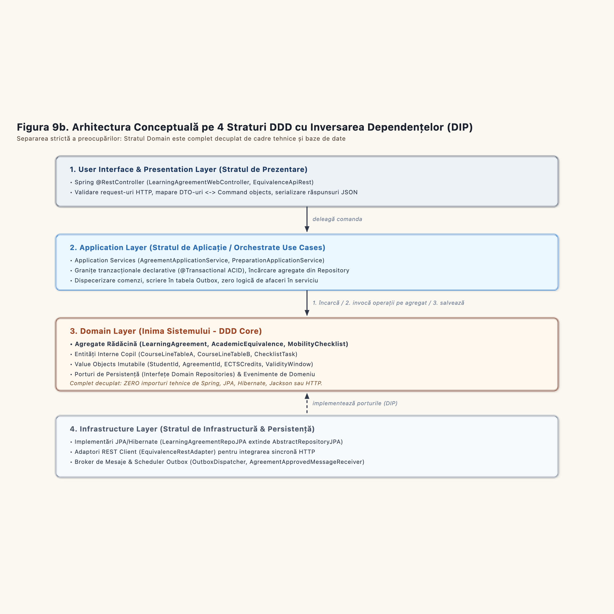

# Chapter 3. Layered Architecture Specifications (Figures 9 and 10)

**Erasmus Mobility Platform (EMP)**  
**Methodological Alignment:** Onion / Hexagonal Architecture (Alistair Cockburn, Jeffrey Palermo) & Course Specifications (FEAA Master SDBIS / SIA)  
**Visual Artifacts:**  
* Figure 9 (Core Domain): `models/diagrams-png/Figura9-Layered-Architecture-Core-Domain.png`  
* Figure 10 (Supporting Subdomain): `models/diagrams-png/Figura10-Layered-Architecture-Supporting-Subdomain.png`  
**PlantUML Sources:**  
* `docs/diagrams/fig9-layered-architecture-core.puml`  
* `docs/diagrams/fig10-layered-architecture-supporting.puml`

---

### 3.1.1 Architectural Principles of the Four-Layer Model

The system isolates domain logic from technical infrastructure using a four-layer architecture. Dependencies flow inward toward the domain. The domain model contains zero imports from web frameworks, SQL libraries, or messaging drivers.

### Layer Responsibilities and Constraints

1. **User Interface Layer:**  
   Acts as the reception desk. It converts external HTTP JSON payloads into internal Command objects. It handles authentication tokens and returns standard HTTP status codes. It contains zero business validation logic.
2. **Application Layer:**  
   Acts as the workflow coordinator. It starts database transactions. It loads aggregates through repository interfaces, verifies cross-context conditions via domain ports, delegates state mutations to aggregate methods, and writes committed domain events to the outbox. It does not calculate domain math.
3. **Domain Layer:**  
   Acts as the vault. It holds the entities, aggregate roots, value objects, and business invariants. It defines repository interfaces as outbound ports. It has zero external dependencies.
4. **Infrastructure Layer:**  
   Acts as the engine room. It implements repository interfaces using JPA Hibernate and Spring Data. It implements messaging ports using RabbitMQ or JMS. It manages network sockets and physical database connections.

---

### 3.1.2 Figure 9: Core Bounded Context (Learning Agreement Management)

In Figure 9, the core domain orchestrates the authoring, ECTS validation, and approval of study contracts:

### Execution Sequence inside `LearningAgreementApplicationService`
1. **Load:** The service loads the `LearningAgreement` aggregate from `LearningAgreementRepo` using `findById(id)`.
2. **Port Check:** The service invokes `EquivalenceQueryPort.verifyCourseAccredited(partnerId, hostCode)` to ensure the foreign subject is accredited.
3. **Domain Execution:** The service invokes `agreement.validateEctsBalance()` and `agreement.submit()`. The aggregate checks the invariant ($\sum A == \sum B \ge 30$). If invalid, it raises an exception and halts the transaction.
4. **Save:** The service commits the mutated aggregate back through `LearningAgreementRepo.save(agreement)`.
5. **Publish Event:** The service routes `LearningAgreementApprovedEvent` to `OutboxEventPublisher`.

### Dependency Inversion in Action
`LearningAgreementRepoJPA` resides in the Infrastructure layer. It implements `LearningAgreementRepo`, which resides in the Domain layer. The domain remains decoupled from SQL or relational tables.

---

### 3.1.3 Figure 10: Supporting Subdomain (Equivalence Management)

In Figure 10, the supporting domain manages the catalog of course syllabi and pre-approved mappings:

### Key Components
* **`EquivalenceCtrl`:** Exposes endpoints for searching the catalog (`/api/equivalences/search`) and registering mappings (`/api/equivalences/register`).
* **`EquivalenceApplicationService`:** Enforces command authorization, loads the `AcademicEquivalence` aggregate, and records audit logs through `AuditLogPort`.
* **`AcademicEquivalenceRepo`:** Domain repository interface defining queries by partner university and course codes.
* **`AcademicEquivalenceRepoJPA`:** Infrastructure adapter providing database persistence.
* **`AuditLogServiceJPA`:** Infrastructure adapter writing immutable audit records directly to the `AUDIT_TRAIL` ledger table.

