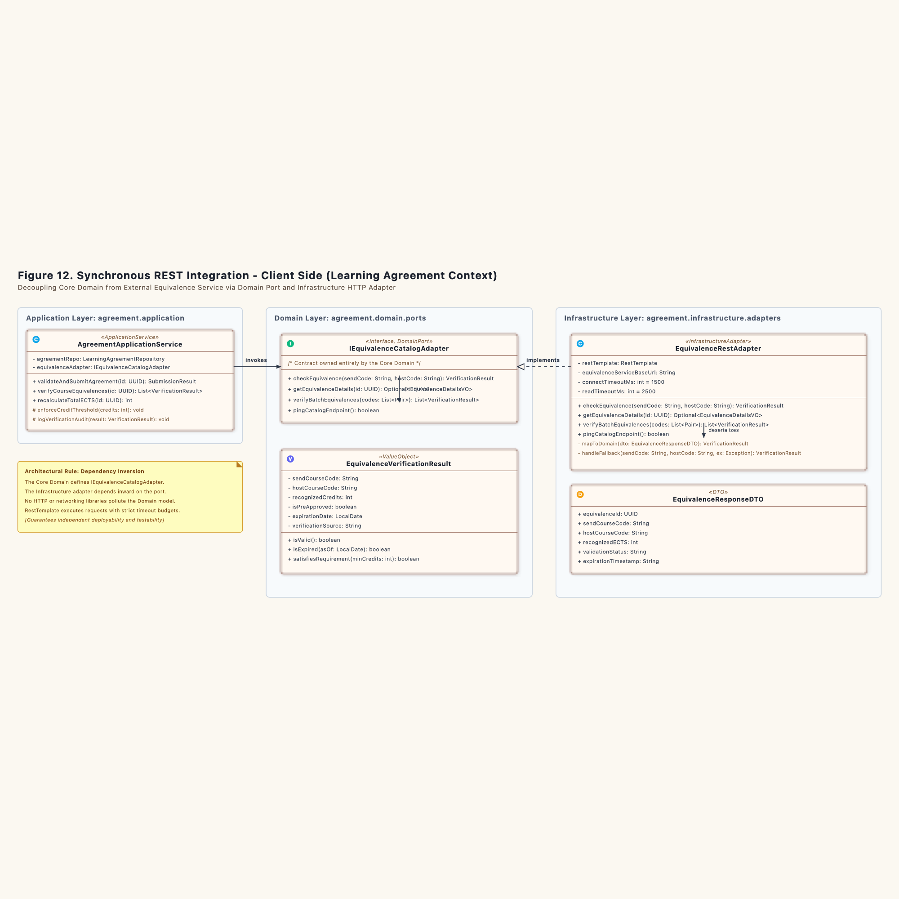
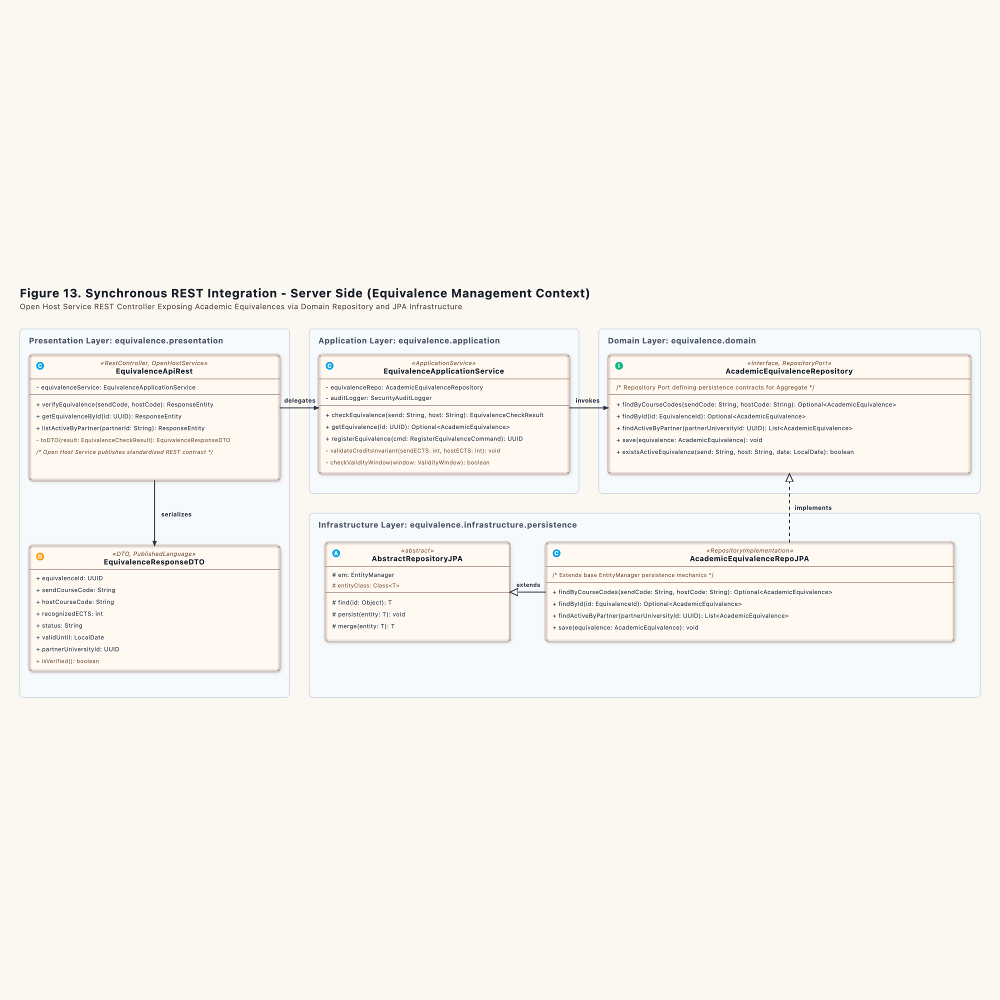

# Synchronous REST Integration Specification (Section 4)

### 4.1.1 Overview and Physical Mechanics

Systems that exchange data synchronously act like two bank tellers communicating through an intercom window. The client teller cannot proceed with paperwork until the server teller stamps the request slip and slides it back through the slot. If the line drops or the server teller walks away, the client teller halts. 

In the Erasmus Mobility Platform, the `Learning Agreement Management` context must verify whether foreign courses qualify for domestic academic credit before a student submits their agreement. Rather than sharing a database table or reading foreign records directly, the system uses a synchronous REST pipeline governed by Hexagonal Architecture principles (Ports and Adapters) and an Open Host Service (OHS).

---

### 4.1.2 Client Side: Learning Agreement Context (Figure 12)

The client architecture isolates the core domain from network protocols and remote server addresses. 



#### The Domain Port: `IEquivalenceCatalogAdapter`
The domain model resides behind a protective boundary. The core domain defines its own requirement through the Java interface `IEquivalenceCatalogAdapter`:

```java
package ro.uaic.feaa.erasmus.agreement.domain.ports;

import ro.uaic.feaa.erasmus.agreement.domain.models.EquivalenceVerificationResult;
import java.util.UUID;
import java.util.Optional;

public interface IEquivalenceCatalogAdapter {
    EquivalenceVerificationResult checkEquivalence(String sendCourseCode, String hostCourseCode);
    Optional<EquivalenceDetailsVO> getEquivalenceDetails(UUID equivalenceId);
}
```

The core domain owns this interface. No HTTP client, JSON annotation, or remote IP address enters this package.

#### The Infrastructure Adapter: `EquivalenceRestAdapter`
The `EquivalenceRestAdapter` lives in the Infrastructure layer. It implements `IEquivalenceCatalogAdapter` and translates domain inquiries into concrete HTTP GET calls:

1. **Request Formation:** The adapter builds an HTTP GET request targeting `/api/v1/equivalences/verify?sendCode={send}&hostCode={host}`.
2. **Circuit Protection and Timeouts:** The HTTP client enforces a connection timeout of 1500 milliseconds and a read timeout of 2500 milliseconds. If the remote endpoint hangs, the adapter halts execution rather than starving local server threads.
3. **Payload Translation:** The remote JSON string enters `EquivalenceResponseDTO`. The adapter parses the response and instantiates an immutable domain value object, `EquivalenceVerificationResult`.

```java
package ro.uaic.feaa.erasmus.agreement.infrastructure.adapters;

import ro.uaic.feaa.erasmus.agreement.domain.ports.IEquivalenceCatalogAdapter;
import ro.uaic.feaa.erasmus.agreement.domain.models.EquivalenceVerificationResult;
import org.springframework.web.client.RestTemplate;
import org.springframework.stereotype.Component;

@Component
public class EquivalenceRestAdapter implements IEquivalenceCatalogAdapter {

    private final RestTemplate restTemplate;
    private final String equivalenceServiceBaseUrl;

    public EquivalenceRestAdapter(RestTemplate restTemplate) {
        this.restTemplate = restTemplate;
        this.equivalenceServiceBaseUrl = "http://equivalence-service:8082/api/v1/equivalences";
    }

    @Override
    public EquivalenceVerificationResult checkEquivalence(String sendCourseCode, String hostCourseCode) {
        String url = String.format("%s/verify?sendCode=%s&hostCode=%s", 
                equivalenceServiceBaseUrl, sendCourseCode, hostCourseCode);
        
        EquivalenceResponseDTO dto = restTemplate.getForObject(url, EquivalenceResponseDTO.class);
        return mapToDomain(dto);
    }

    private EquivalenceVerificationResult mapToDomain(EquivalenceResponseDTO dto) {
        if (dto == null) {
            return EquivalenceVerificationResult.unverified();
        }
        return new EquivalenceVerificationResult(
            dto.getSendCourseCode(),
            dto.getHostCourseCode(),
            dto.getRecognizedECTS(),
            "ACTIVE".equalsIgnoreCase(dto.getValidationStatus()),
            dto.getExpirationDate()
        );
    }
}
```

---

### 4.1.3 Server Side: Equivalence Management Context (Figure 13)

The supporting subdomain publishes an Open Host Service (OHS). It presents a standard contract to external consumers while isolating its own JPA entities.



#### The Open Host Service Controller: `EquivalenceApiRest`
The REST controller accepts inbound HTTP requests, unwraps query parameters, and delegates execution to `EquivalenceApplicationService`:

```java
package ro.uaic.feaa.erasmus.equivalence.presentation;

import ro.uaic.feaa.erasmus.equivalence.application.EquivalenceApplicationService;
import ro.uaic.feaa.erasmus.equivalence.application.dto.EquivalenceResponseDTO;
import org.springframework.http.ResponseEntity;
import org.springframework.web.bind.annotation.*;

@RestController
@RequestMapping("/api/v1/equivalences")
public class EquivalenceApiRest {

    private final EquivalenceApplicationService equivalenceService;

    public EquivalenceApiRest(EquivalenceApplicationService equivalenceService) {
        this.equivalenceService = equivalenceService;
    }

    @GetMapping("/verify")
    public ResponseEntity<EquivalenceResponseDTO> verifyEquivalence(
            @RequestParam String sendCode,
            @RequestParam String hostCode) {
        
        EquivalenceCheckResult result = equivalenceService.checkEquivalence(sendCode, hostCode);
        return ResponseEntity.ok(toDTO(result));
    }

    private EquivalenceResponseDTO toDTO(EquivalenceCheckResult result) {
        return new EquivalenceResponseDTO(
            result.getEquivalenceId(),
            result.getSendCode(),
            result.getHostCode(),
            result.getRecognizedECTS(),
            result.getStatus().name(),
            result.getValidUntil()
        );
    }
}
```

#### Application Service and Persistence Dispatch
`EquivalenceApplicationService` queries `AcademicEquivalenceRepository`. The call resolves against `AcademicEquivalenceRepoJPA`, which extends `AbstractRepositoryJPA`. 

The query matches course identifiers and verifies that the current date falls inside `ValidityWindow`. If the course mapping exists and remains valid, the service returns confirmed credits. If the record is missing or expired, it returns an explicit invalid status. The database connection closes before HTTP response serialization begins.

---

### 4.1.4 Boundary Failure Modes and Defense Rules

1. **Remote Timeout:** If `Equivalence Context` exceeds the 2500 ms limit, `EquivalenceRestAdapter` throws a `RemoteServiceUnavailableException`. The calling agreement service marks verification as pending and prompts the student to retry later. It never submits unverified agreements.
2. **Schema Drift:** The server serializes responses into `EquivalenceResponseDTO`. If the server adds extra metadata fields, client deserialization ignores unknown properties. The contract remains intact.
3. **Network Partition:** If the network link breaks, read operations fail fast. The local database of `Learning Agreement Management` remains uncorrupted.

