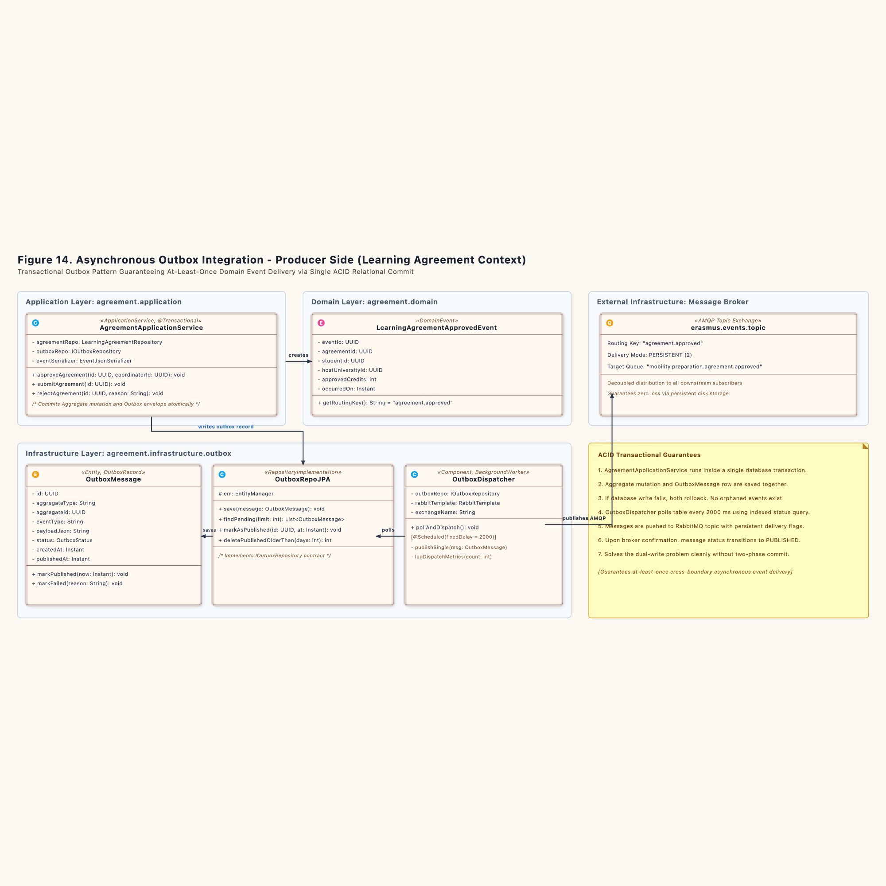
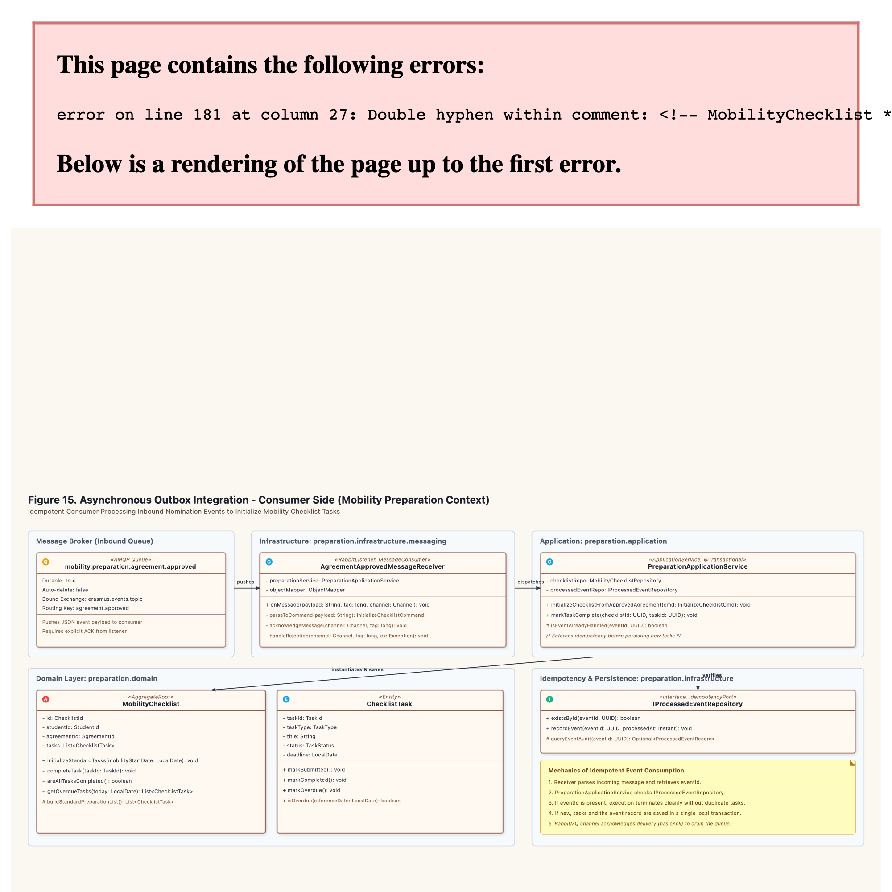

# Asynchronous Outbox Integration Specification (Section 4)

### 4.2.1 Overview and Physical Mechanics

Asynchronous messaging without distributed transactions behaves like an office clerk placing a carbon copy of a signed contract into an outgoing postal tray. The clerk does not walk the document across town immediately. The clerk signs the primary ledger, drops the duplicate envelope into the tray, and closes the safe. Both actions happen at the same desk in one motion.

Later, a courier empties the tray and carries letters to the postal hub. If the courier drops an envelope in the mud, the courier picks up another duplicate from the tray. The receiving clerk checks their inward logbook: if an identical letter arrived five minutes earlier, they file the duplicate into the shredder bin without re-entering the order.

The Transactional Outbox pattern guarantees at-least-once message delivery across bounded contexts while completely avoiding distributed two-phase commit (2PC) locks.

---

### 4.2.2 Producer Side: Learning Agreement Context (Figure 14)

When a faculty coordinator approves a student's learning agreement, downstream contexts must take immediate preparatory actions. `Learning Agreement Context` produces domain events without tying its local database transaction to an external message broker.



#### The Atomic Local Transaction
`AgreementApplicationService.approveAgreement()` executes within a standard Spring `@Transactional` scope:

```java
package ro.uaic.feaa.erasmus.agreement.application;

import ro.uaic.feaa.erasmus.agreement.domain.models.LearningAgreement;
import ro.uaic.feaa.erasmus.agreement.domain.events.LearningAgreementApprovedEvent;
import ro.uaic.feaa.erasmus.agreement.domain.ports.LearningAgreementRepository;
import ro.uaic.feaa.erasmus.agreement.domain.ports.IOutboxRepository;
import ro.uaic.feaa.erasmus.agreement.infrastructure.outbox.OutboxMessage;
import org.springframework.stereotype.Service;
import org.springframework.transaction.annotation.Transactional;
import java.util.UUID;
import java.time.Instant;

@Service
public class AgreementApplicationService {

    private final LearningAgreementRepository agreementRepo;
    private final IOutboxRepository outboxRepo;
    private final EventJsonSerializer eventSerializer;

    public AgreementApplicationService(LearningAgreementRepository agreementRepo,
                                       IOutboxRepository outboxRepo,
                                       EventJsonSerializer eventSerializer) {
        this.agreementRepo = agreementRepo;
        this.outboxRepo = outboxRepo;
        this.eventSerializer = eventSerializer;
    }

    @Transactional
    public void approveAgreement(UUID agreementId, UUID coordinatorId) {
        LearningAgreement agreement = agreementRepo.findById(agreementId)
            .orElseThrow(() -> new IllegalArgumentException("Agreement not found: " + agreementId));

        // State mutation inside Aggregate Root
        LearningAgreementApprovedEvent event = agreement.approve(coordinatorId);
        agreementRepo.save(agreement);

        // Serialize event envelope to outbox table in the same ACID transaction
        OutboxMessage outboxMessage = new OutboxMessage(
            UUID.randomUUID(),
            "LearningAgreement",
            agreement.getId(),
            event.getClass().getSimpleName(),
            eventSerializer.serialize(event),
            Instant.now()
        );
        outboxRepo.save(outboxMessage);
    }
}
```

If the database server loses power during execution, both the aggregate update and the outbox row vanish. If the write succeeds, both persist together. 

#### The Background Scheduler: `OutboxDispatcher`
The application does not block HTTP requests to communicate with RabbitMQ. Instead, an independent background daemon polls the database table:

```java
package ro.uaic.feaa.erasmus.agreement.infrastructure.outbox;

import ro.uaic.feaa.erasmus.agreement.domain.ports.IOutboxRepository;
import org.springframework.scheduling.annotation.Scheduled;
import org.springframework.amqp.rabbit.core.RabbitTemplate;
import org.springframework.stereotype.Component;
import java.util.List;
import java.time.Instant;

@Component
public class OutboxDispatcher {

    private final IOutboxRepository outboxRepo;
    private final RabbitTemplate rabbitTemplate;
    private static final String EXCHANGE = "erasmus.events.topic";
    private static final String ROUTING_KEY = "agreement.approved";

    public OutboxDispatcher(IOutboxRepository outboxRepo, RabbitTemplate rabbitTemplate) {
        this.outboxRepo = outboxRepo;
        this.rabbitTemplate = rabbitTemplate;
    }

    @Scheduled(fixedDelay = 2000)
    public void pollAndDispatch() {
        List<OutboxMessage> pendingMessages = outboxRepo.findPendingMessages(50);

        for (OutboxMessage msg : pendingMessages) {
            try {
                rabbitTemplate.convertAndSend(EXCHANGE, ROUTING_KEY, msg.getPayloadJson());
                outboxRepo.markAsPublished(msg.getId(), Instant.now());
            } catch (Exception ex) {
                // Network drops or broker downtime leave record in PENDING state
                break;
            }
        }
    }
}
```

The worker reads up to 50 pending records. It forwards each payload to RabbitMQ exchange `erasmus.events.topic` and updates the outbox status to `PUBLISHED`. If RabbitMQ crashes, messages wait safely on disk until connectivity returns.

---

### 4.2.3 Consumer Side: Mobility Preparation Context (Figure 15)

The `Mobility Preparation Context` subscribes to the message broker to initialize logistical checklists as soon as nominations achieve formal approval.



#### Idempotent Message Receiver: `AgreementApprovedMessageReceiver`
Because networks can fail during delivery acknowledgments, the broker may deliver identical messages multiple times. The receiver handles duplicate deliveries through explicit verification:

```java
package ro.uaic.feaa.erasmus.preparation.infrastructure.messaging;

import ro.uaic.feaa.erasmus.preparation.application.PreparationApplicationService;
import ro.uaic.feaa.erasmus.preparation.application.commands.InitializeChecklistCommand;
import com.fasterxml.jackson.databind.ObjectMapper;
import com.rabbitmq.client.Channel;
import org.springframework.amqp.rabbit.annotation.RabbitListener;
import org.springframework.amqp.support.AmqpHeaders;
import org.springframework.messaging.handler.annotation.Header;
import org.springframework.stereotype.Component;

@Component
public class AgreementApprovedMessageReceiver {

    private final PreparationApplicationService preparationService;
    private final ObjectMapper objectMapper;

    public AgreementApprovedMessageReceiver(PreparationApplicationService preparationService, 
                                           ObjectMapper objectMapper) {
        this.preparationService = preparationService;
        this.objectMapper = objectMapper;
    }

    @RabbitListener(queues = "mobility.preparation.agreement.approved", ackMode = "MANUAL")
    public void onMessage(String payload, 
                          @Header(AmqpHeaders.DELIVERY_TAG) long deliveryTag, 
                          Channel channel) throws Exception {
        try {
            AgreementApprovedPayloadDTO dto = objectMapper.readValue(payload, AgreementApprovedPayloadDTO.class);
            InitializeChecklistCommand cmd = new InitializeChecklistCommand(
                dto.getEventId(),
                dto.getAgreementId(),
                dto.getStudentId(),
                dto.getHostUniversityId()
            );

            preparationService.initializeChecklistFromApprovedAgreement(cmd);
            channel.basicAck(deliveryTag, false);
        } catch (Exception ex) {
            channel.basicNack(deliveryTag, false, true);
        }
    }
}
```

#### Idempotency Filter in the Application Layer
The consumer verifies uniqueness before writing new records:

```java
package ro.uaic.feaa.erasmus.preparation.application;

import ro.uaic.feaa.erasmus.preparation.domain.models.MobilityChecklist;
import ro.uaic.feaa.erasmus.preparation.domain.ports.MobilityChecklistRepository;
import ro.uaic.feaa.erasmus.preparation.domain.ports.IProcessedEventRepository;
import org.springframework.stereotype.Service;
import org.springframework.transaction.annotation.Transactional;
import java.time.Instant;

@Service
public class PreparationApplicationService {

    private final MobilityChecklistRepository checklistRepo;
    private final IProcessedEventRepository processedEventRepo;

    public PreparationApplicationService(MobilityChecklistRepository checklistRepo,
                                         IProcessedEventRepository processedEventRepo) {
        this.checklistRepo = checklistRepo;
        this.processedEventRepo = processedEventRepo;
    }

    @Transactional
    public void initializeChecklistFromApprovedAgreement(InitializeChecklistCommand cmd) {
        // Idempotency check: Guard against duplicate message deliveries
        if (processedEventRepo.existsById(cmd.getEventId())) {
            return;
        }

        // Initialize aggregate with standard preparation items
        MobilityChecklist checklist = new MobilityChecklist(
            cmd.getAgreementId(),
            cmd.getStudentId()
        );
        checklist.initializeDefaultPreparationTasks();

        checklistRepo.save(checklist);
        processedEventRepo.recordEvent(cmd.getEventId(), Instant.now());
    }
}
```

If the message arrives twice, `processedEventRepo.existsById(cmd.getEventId())` returns true. The service drops duplicate execution immediately. The consumer then issues `basicAck` to remove the redundant message from the broker queue.

---

### 4.2.4 Failure Modes and Recovery Invariants

1. **Broker Failure on Publish:** If the message broker rejects connections, the dispatcher halts polling. Records stay marked as `PENDING` in the outbox table. No events are lost.
2. **Crash Before Manual ACK:** If the consumer server loses power after persisting tasks but before running `basicAck`, RabbitMQ redelivers the message upon server restart. The receiver runs its check against `IProcessedEventRepository`, detects the prior commit, skips duplicate task generation, and delivers the delayed ACK.
3. **Poison Message Defense:** If a corrupted JSON payload enters the queue, Jackson deserialization fails. The receiver dead-letters the message into `erasmus.dlq` after three attempts, preventing infinite processing loops.

