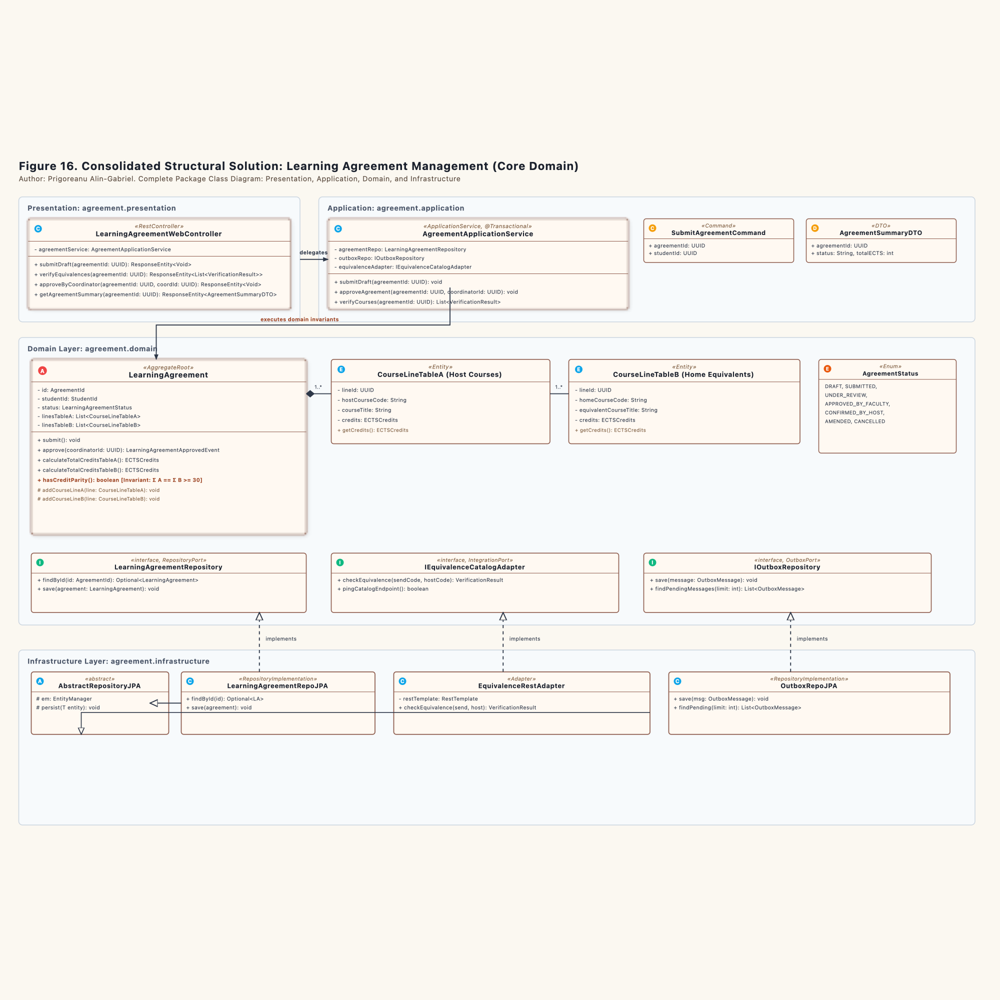
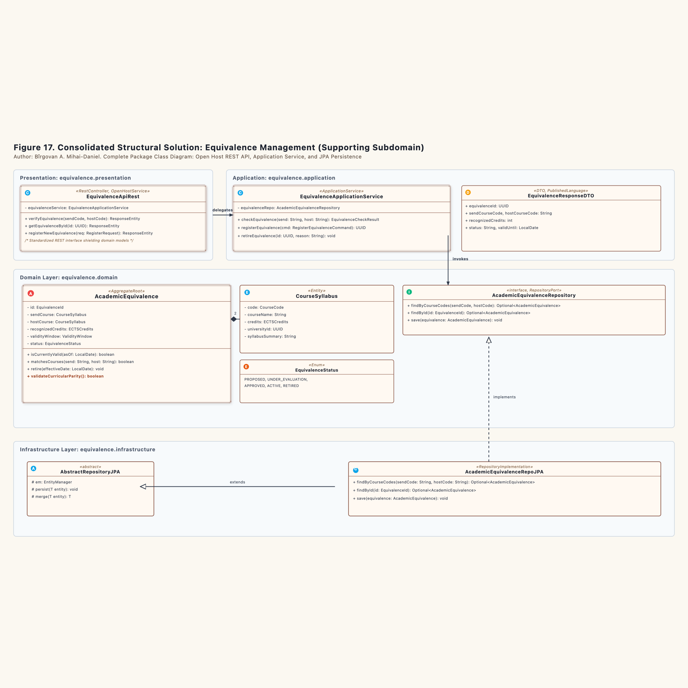
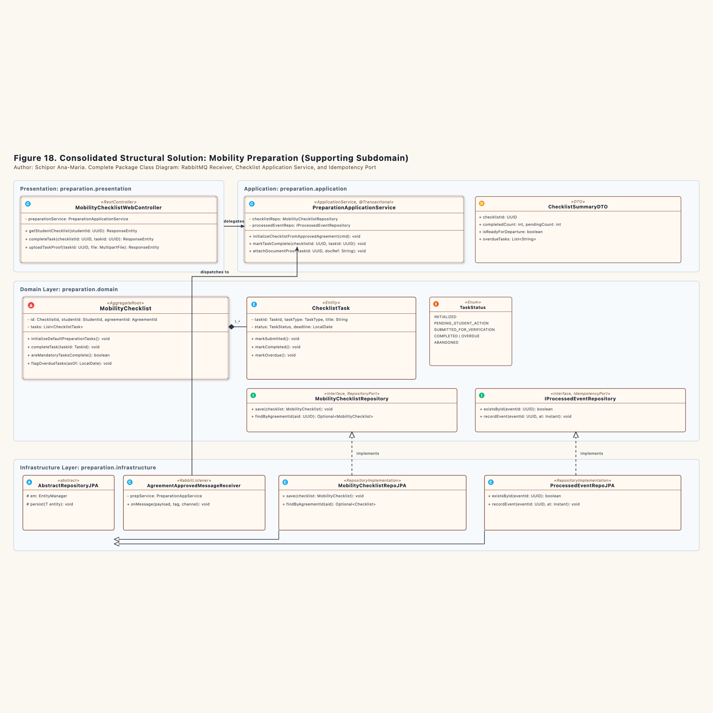

# Consolidated Structural Architecture Models (Section 5)

## 5.1 Overview and Architectural Mechanics

A large software platform resembles an industrial dockyard divided into specialized workshops. The steel hull fabrication shop does not store nautical charts, and the navigation instrument lab does not pour molten ballast. Each shop maintains its own inventory counters, tools, and access doorways.

In the Erasmus Mobility Platform, the system divides responsibility across three Bounded Contexts. Each bounded context operates a four-layer architecture with strictly managed dependencies pointing inward toward the domain core. 

---

## 5.2 Learning Agreement Management Structural Model (Figure 16)

The core domain owns the legal study contracts negotiated among the student, the home faculty, and the host institution.

### 5.2.1 Package Decomposition
1. **`ro.uaic.feaa.erasmus.agreement.presentation`**: Houses `LearningAgreementWebController`. It parses incoming HTTP payloads, checks caller permissions, and translates application results into HTTP status codes.
2. **`ro.uaic.feaa.erasmus.agreement.application`**: Contains `AgreementApplicationService`. It acts as the coordinator. It loads the aggregate, calls domain ports to verify external syllabus mappings, invokes business invariants on the aggregate, and saves results atomically.
3. **`ro.uaic.feaa.erasmus.agreement.domain`**:
   * **Aggregate Root:** `LearningAgreement`. Controls the consistency boundary. External callers cannot modify child course lines directly.
   * **Child Entities:** `CourseLineTableA` (host institutional catalog items) and `CourseLineTableB` (home faculty equivalent items).
   * **Value Objects:** `AgreementId`, `StudentId`, `ECTSCredits`, and `AcademicYear`.
   * **State Enum:** `LearningAgreementStatus` with seven explicit phases.
   * **Domain Ports:** `LearningAgreementRepository`, `IEquivalenceCatalogAdapter`, and `IOutboxRepository`.
4. **`ro.uaic.feaa.erasmus.agreement.infrastructure`**: Implements domain interfaces using technical persistence tools. `LearningAgreementRepoJPA` and `OutboxRepoJPA` derive from `AbstractRepositoryJPA`. `EquivalenceRestAdapter` uses Spring `RestTemplate` with strict timeouts.

---

## 5.3 Equivalence Management Structural Model (Figure 17)

The supporting subdomain functions as an authoritative reference catalog. It registers historical academic equivalences and assesses curricular overlap.

### 5.3.1 Package Decomposition
1. **`ro.uaic.feaa.erasmus.equivalence.presentation`**: Features `EquivalenceApiRest`, designed as an Open Host Service (OHS). It shields external consumers from internal table changes by returning immutable `EquivalenceResponseDTO` instances.
2. **`ro.uaic.feaa.erasmus.equivalence.application`**: Contains `EquivalenceApplicationService`. It handles command execution for syllabus evaluations, new equivalence registrations, and catalog retirement.
3. **`ro.uaic.feaa.erasmus.equivalence.domain`**:
   * **Aggregate Root:** `AcademicEquivalence`. Pairs domestic courses with foreign counterparts and enforces European Credit Transfer System (ECTS) validity.
   * **Child Entity / Value Object:** `CourseSyllabus`, detailing lecture hours, thematic modules, and grading criteria.
   * **Value Objects:** `EquivalenceId`, `CourseCode`, `ECTSCredits`, and `ValidityWindow`.
   * **State Enum:** `EquivalenceStatus`.
   * **Repository Port:** `AcademicEquivalenceRepository`.
4. **`ro.uaic.feaa.erasmus.equivalence.infrastructure`**: Houses `AcademicEquivalenceRepoJPA`, extending `AbstractRepositoryJPA` to run queries against relational tables through the JPA `EntityManager`.

---

## 5.4 Mobility Preparation Structural Model (Figure 18)

The supporting subdomain manages administrative onboarding and logistical verification for selected students.

### 5.4.1 Package Decomposition
1. **`ro.uaic.feaa.erasmus.preparation.presentation`**: Contains `MobilityChecklistWebController` for student self-service interactions, document uploads, and milestone progress queries.
2. **`ro.uaic.feaa.erasmus.preparation.application`**: Contains `PreparationApplicationService`. It verifies event idempotency, initializes checklist templates, and stamps completed milestones.
3. **`ro.uaic.feaa.erasmus.preparation.domain`**:
   * **Aggregate Root:** `MobilityChecklist`. Manages the full list of preparation tasks assigned to a nominated student.
   * **Internal Entity:** `ChecklistTask`, representing individual items such as insurance policies, language assessments, and grant contract signatures.
   * **Value Objects:** `ChecklistId`, `TaskId`, `TaskType`, and `Deadline`.
   * **State Enum:** `TaskStatus` with six distinct lifecycle stages.
   * **Ports:** `MobilityChecklistRepository` and `IProcessedEventRepository`.
4. **`ro.uaic.feaa.erasmus.preparation.infrastructure`**: Contains `AgreementApprovedMessageReceiver` listening on RabbitMQ queue `mobility.preparation.agreement.approved`. Persistence relies on `MobilityChecklistRepoJPA` and `ProcessedEventRepoJPA`.

