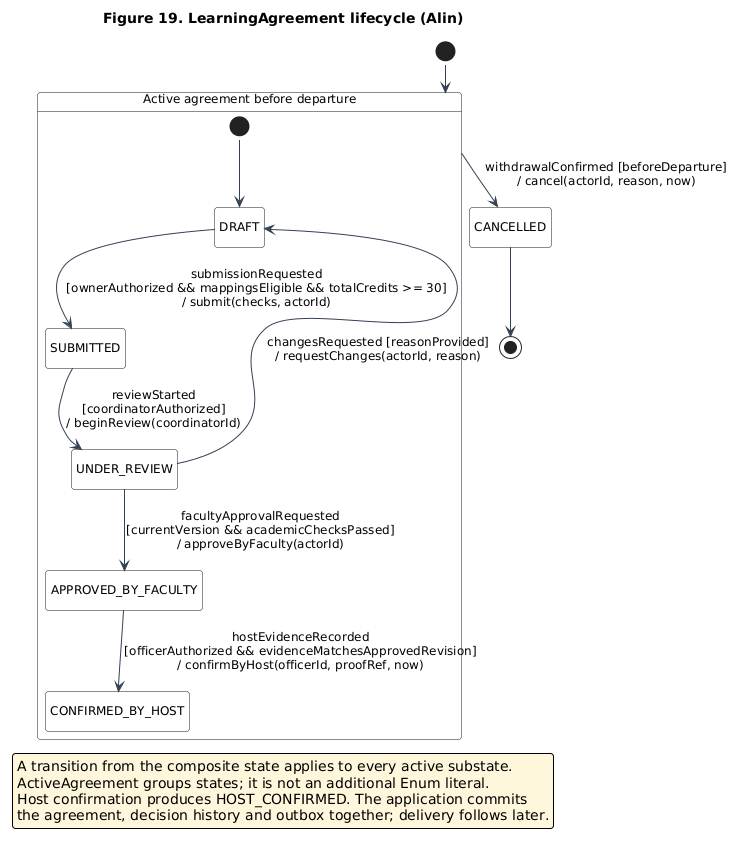
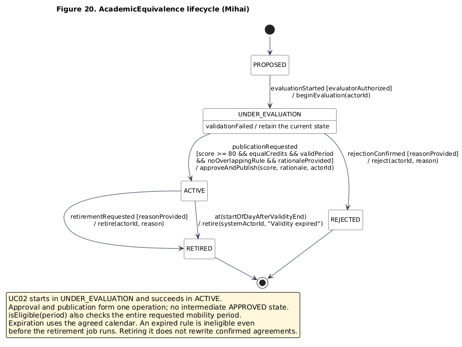
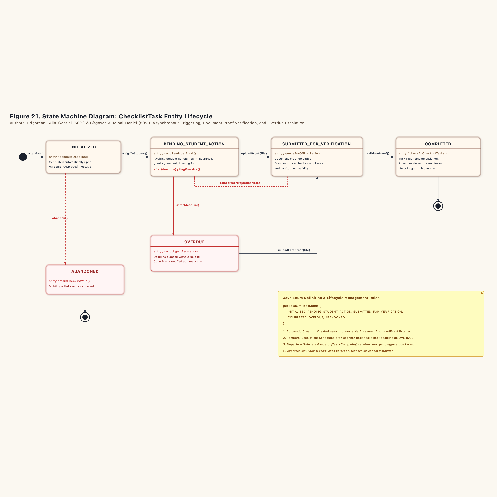

# Dynamic Behavior Modeling: Aggregate State Machine Specifications

This document defines the formal behavioral lifecycles for the core aggregates across the three bounded contexts of the Erasmus Mobility Platform (EMP). Each state machine is authored by a dedicated team member and enforces business invariants through package-private transition methods, guard conditions, and event publications.

---

### 6.1.1 Team Allocations and Lifecycle Scope

| Aggregate Root / Entity | Subdomain Context | Primary Author | State Enum Class | Associated Diagram |
| :--- | :--- | :--- | :--- | :--- |
| `LearningAgreement` | `Learning Agreement Management` (Core Domain) | Prigoreanu Alin-Gabriel | `LearningAgreementStatus` | Figure 19 |
| `AcademicEquivalence` | `Equivalence Management` (Supporting Subdomain) | Bîrgovan A. Mihai-Daniel | `EquivalenceStatus` | Figure 20 |
| `ChecklistTask` | `Mobility Preparation` (Supporting Subdomain) | Prigoreanu Alin-Gabriel (50%) & Bîrgovan A. Mihai-Daniel (50%) | `TaskStatus` | Figure 21 |

---

### 6.1.2 Learning Agreement Aggregate Lifecycle (Student 1: Prigoreanu Alin-Gabriel)

`LearningAgreementStatus` is `DRAFT`, `SUBMITTED`, `UNDER_REVIEW`, `APPROVED_BY_FACULTY`, `CONFIRMED_BY_HOST`, or `CANCELLED`.

| Transition | Guard / result |
|---|---|
| Initial → `DRAFT` | Create the persisted working draft. |
| `DRAFT` → `SUBMITTED` | Student owns it; every mapping is eligible; mappings are 1:1 with equal credits; semester total is at least 30 ECTS. |
| `SUBMITTED` → `UNDER_REVIEW` | Authorized coordinator begins review. |
| `UNDER_REVIEW` → `DRAFT` | Coordinator requests corrections with a reason. |
| `UNDER_REVIEW` → `APPROVED_BY_FACULTY` | Current version and academic checks pass. |
| `APPROVED_BY_FACULTY` → `CONFIRMED_BY_HOST` | DRI records evidence for the approved revision; agreement, decision, and outbox are committed locally. |
| Any active pre-departure state → `CANCELLED` | Authorized cancellation is recorded; terminal state. |

UC01 ends at persisted `SUBMITTED`; Figure 19 continues the same aggregate lifecycle through review and host evidence. Failed submission leaves the persisted draft unchanged. There is no `AMENDED` state in this project scope.

### 6.1.3 Academic Equivalence Aggregate Lifecycle (Student 2: Bîrgovan A. Mihai-Daniel)

`EquivalenceStatus` is `PROPOSED`, `UNDER_EVALUATION`, `ACTIVE`, `REJECTED`, or `RETIRED`.

| Transition | Guard / result |
|---|---|
| Initial → `PROPOSED` | Record a submitted course-pair proposal. |
| `PROPOSED` → `UNDER_EVALUATION` | Authorized evaluator begins assessment; this precedes UC02. |
| `UNDER_EVALUATION` → `ACTIVE` | UC02 atomically validates score ≥80/100, equal credits, validity for the full mobility period, no overlap, and rationale; saves decision and rule. |
| `UNDER_EVALUATION` → `REJECTED` | Evaluator records an explicit rejection with a reason. |
| `ACTIVE` → `RETIRED` | Authorized retirement or validity expiry. |

A validation failure in UC02 leaves the proposal `UNDER_EVALUATION`; it is not an explicit rejection. The 80/100 threshold is a project policy. No intermediate `APPROVED` status exists: evaluation and publication are one operation.

### 6.1.4 Mobility Preparation Task Lifecycle (shared)

`ChecklistTask` tracks one requirement in the existing mobility dossier.

`TaskStatus` is `INITIALIZED`, `PENDING_STUDENT_ACTION`, `SUBMITTED_FOR_VERIFICATION`, `COMPLETED`, `OVERDUE`, or `ABANDONED`.

| Transition | Guard / result |
|---|---|
| Initial → `INITIALIZED` → `PENDING_STUDENT_ACTION` | Nomination creates the checklist once; the task is assigned to the student. |
| `PENDING_STUDENT_ACTION` → `SUBMITTED_FOR_VERIFICATION` | Student submits valid administrative proof. |
| `SUBMITTED_FOR_VERIFICATION` → `PENDING_STUDENT_ACTION` | DRI rejects the proof with a reason. |
| `PENDING_STUDENT_ACTION` → `OVERDUE` | A deadline check finds the due date passed and no proof submitted. |
| `OVERDUE` → `SUBMITTED_FOR_VERIFICATION` | Student submits late proof. |
| `SUBMITTED_FOR_VERIFICATION` → `COMPLETED` | DRI approves the proof. |
| `PENDING_STUDENT_ACTION` or `OVERDUE` → `COMPLETED` | A valid host-confirmation event completes the existing academic task; no PDF upload is required. |
| Active task → `ABANDONED` | Mobility cancellation is applied; completed evidence remains history. |

A submitted proof does not become overdue while awaiting DRI review. Rejected proof can become overdue on a later deadline scan. Task changes are made through `MobilityChecklist`; the checklist is initialized at nomination and is not recreated by host-confirmation events.
