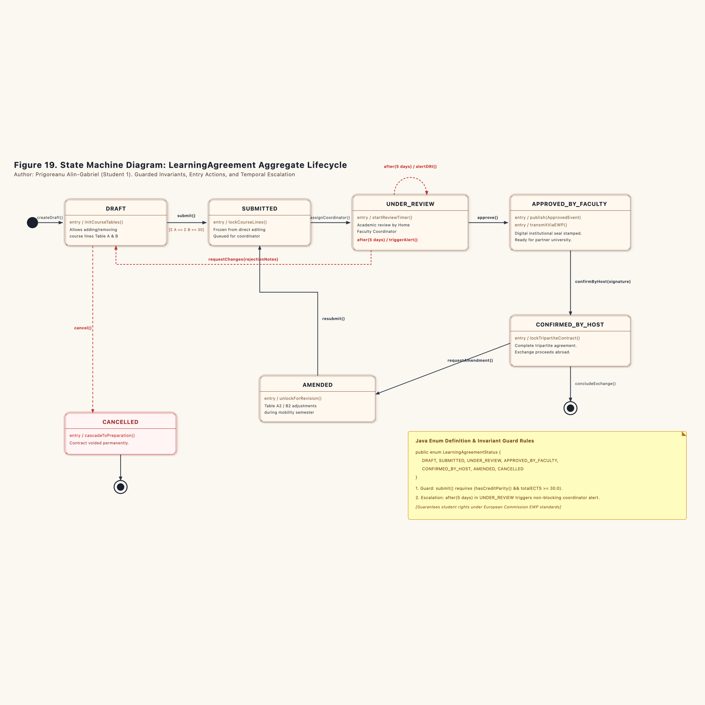
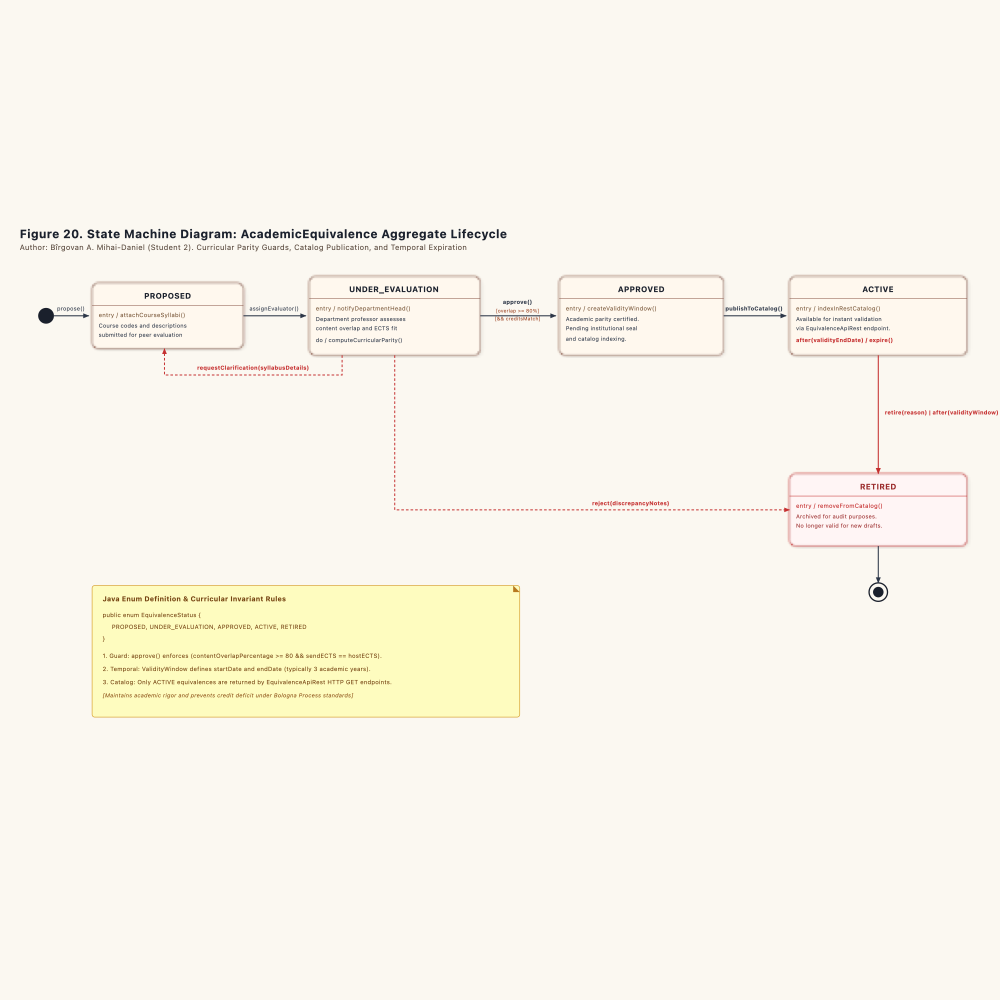
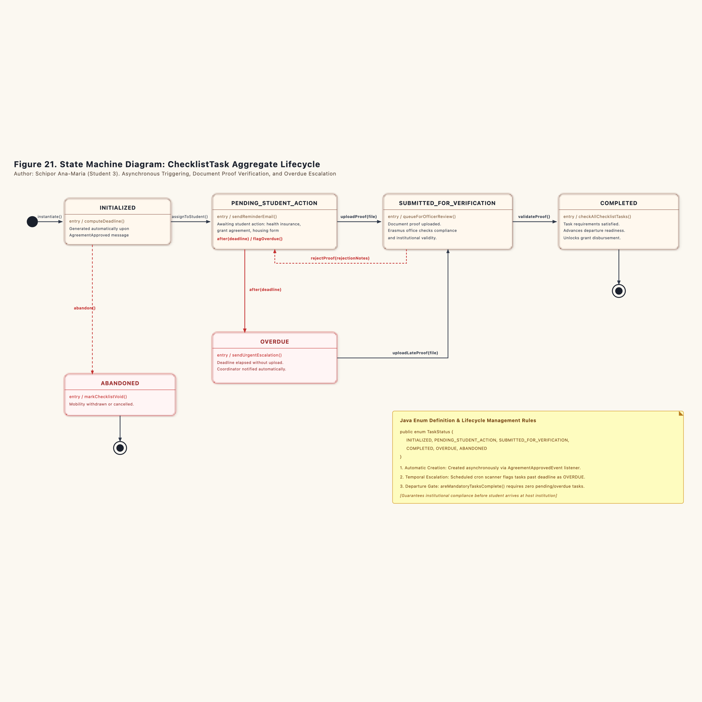

# Dynamic Behavior Modeling: Aggregate State Machine Specifications

This document defines the formal behavioral lifecycles for the core aggregates across the three bounded contexts of the Erasmus Mobility Platform (EMP). Each state machine is authored by a dedicated team member and enforces business invariants through package-private transition methods, guard conditions, and event publications.

---

## 1. Team Allocations

| Aggregate Root / Entity | Subdomain Context | Primary Author | State Enum Class | Associated Diagram |
| :--- | :--- | :--- | :--- | :--- |
| `LearningAgreement` | `Learning Agreement Management` (Core Domain) | Prigoreanu Alin-Gabriel | `LearningAgreementStatus` | Figure 19 |
| `AcademicEquivalence` | `Equivalence Management` (Supporting Subdomain) | Bîrgovan A. Mihai-Daniel | `EquivalenceStatus` | Figure 20 |
| `ChecklistTask` | `Mobility Preparation` (Supporting Subdomain) | Schipor Ana-Maria | `TaskStatus` | Figure 21 |

---

## 2. Learning Agreement Aggregate Lifecycle (Student 1: Prigoreanu Alin-Gabriel)

The `LearningAgreement` aggregate coordinates the core academic contract between the exchange student, the home university, and the host institution.



### 2.1 State Definitions (`LearningAgreementStatus`)

```java
package ro.uaic.feaa.erasmus.agreement.domain;

public enum LearningAgreementStatus {
    DRAFT,
    SUBMITTED,
    UNDER_REVIEW,
    APPROVED_BY_FACULTY,
    CONFIRMED_BY_HOST,
    AMENDED,
    CANCELLED
}
```

* **`DRAFT`**: The initial working slate. The student freely adds, edits, or removes course lines in Table A (host offerings) and Table B (home recognitions).
* **`SUBMITTED`**: The agreement is locked against student edits and queued for departmental assignment.
* **`UNDER_REVIEW`**: Assigned to the designated faculty coordinator for academic curriculum inspection.
* **`APPROVED_BY_FACULTY`**: Stamped with the institutional digital seal. Triggers publication of `LearningAgreementApprovedEvent` to the transactional outbox ledger.
* **`CONFIRMED_BY_HOST`**: Counter-signed by the receiving partner institution via Erasmus Without Paper (EWP) network. Represents a binding tripartite contract.
* **`AMENDED`**: Reopened during the mobility semester for exceptional course adjustments (Table A2 and Table B2).
* **`CANCELLED`**: Permanently revoked due to student withdrawal, severe credit deficit, or administrative disqualification.

### 2.2 Transitions and Invariant Guards

```
[Initial] ---> DRAFT : createDraft()
DRAFT ---> SUBMITTED : submit() [Guard: hasCreditParity() && totalECTS >= 30.0]
SUBMITTED ---> UNDER_REVIEW : assignCoordinator(coordinatorId)
UNDER_REVIEW ---> APPROVED_BY_FACULTY : approve()
UNDER_REVIEW ---> DRAFT : requestChanges(rejectionNotes)
UNDER_REVIEW ---> UNDER_REVIEW : after(5 business days) / alertDRI()
APPROVED_BY_FACULTY ---> CONFIRMED_BY_HOST : confirmByHost(signatureToken)
CONFIRMED_BY_HOST ---> AMENDED : requestAmendment()
AMENDED ---> SUBMITTED : resubmit() [Guard: hasCreditParity()]
{DRAFT, SUBMITTED, UNDER_REVIEW} ---> CANCELLED : cancel(cancellationReason)
CONFIRMED_BY_HOST ---> [Final Terminal] : concludeExchange()
CANCELLED ---> [Final Terminal]
```

### 2.3 Operational Mechanics

1. **Credit Parity Guard (`hasCreditParity()`):** The aggregate prevents any transition from `DRAFT` to `SUBMITTED` unless the sum of ECTS credits in Table A equals the sum of credits in Table B, and the total reaches at least 30.0 credits for a standard semester.
2. **Temporal Review Alert:** If an agreement remains in `UNDER_REVIEW` for more than 5 business days without coordinator action, a non-blocking background timer fires `alertDRI()`. This notifies the Department of International Relations to prevent administrative bottlenecks.
3. **Event Trigger on Approval:** Entering `APPROVED_BY_FACULTY` executes an entry action that emits `LearningAgreementApprovedEvent`. The application service commits this event into the local outbox table inside the same database transaction.

---

## 3. Academic Equivalence Aggregate Lifecycle (Student 2: Bîrgovan A. Mihai-Daniel)

The `AcademicEquivalence` aggregate governs verified course mapping rules between sending and receiving academic programs.



### 3.1 State Definitions (`EquivalenceStatus`)

```java
package ro.uaic.feaa.erasmus.equivalence.domain;

public enum EquivalenceStatus {
    PROPOSED,
    UNDER_EVALUATION,
    APPROVED,
    ACTIVE,
    RETIRED
}
```

* **`PROPOSED`**: Raw course syllabus mapping submitted by a student or academic advisor.
* **`UNDER_EVALUATION`**: Under rigorous assessment by a departmental subject-matter professor.
* **`APPROVED`**: Academic equivalence confirmed by faculty resolution. Validity window is established.
* **`ACTIVE`**: Published in the catalog and open for automatic verification via REST endpoints.
* **`RETIRED`**: Archived and no longer eligible for newly submitted learning agreements. Historical records remain preserved for audit compliance.

### 3.2 Transitions and Invariant Guards

```
[Initial] ---> PROPOSED : propose()
PROPOSED ---> UNDER_EVALUATION : assignEvaluator(evaluatorId)
UNDER_EVALUATION ---> PROPOSED : requestClarification(syllabusDetails)
UNDER_EVALUATION ---> APPROVED : approve() [Guard: contentOverlap >= 80% && creditsMatch]
UNDER_EVALUATION ---> RETIRED : reject(discrepancyNotes)
APPROVED ---> ACTIVE : publishToCatalog() [entry / indexInRestCatalog()]
ACTIVE ---> RETIRED : retire(reason)
ACTIVE ---> RETIRED : after(validityWindow.endDate) / expire()
RETIRED ---> [Final Terminal]
```

### 3.3 Operational Mechanics

1. **Curricular Parity Guard:** The transition to `APPROVED` requires programmatic verification that the home and host syllabi share at least 80% core thematic overlap, and that the allocated ECTS credits match.
2. **Catalog Indexing:** Only records in `ACTIVE` state are exposed through the Open Host Service REST API (`/api/equivalences/search`). Any draft, pending, or retired records remain invisible to external queries.
3. **Temporal Expiration:** A scheduled maintenance task evaluates the `ValidityWindow` value object daily. When the end date lapses (typically after 3 academic years), the aggregate transitions into `RETIRED`.

---

## 4. Mobility Preparation Task Lifecycle (Student 3: Schipor Ana-Maria)

The `ChecklistTask` entity tracks individual administrative readiness requirements before a student departs for their study abroad program.



### 4.1 State Definitions (`TaskStatus`)

```java
package ro.uaic.feaa.erasmus.preparation.domain;

public enum TaskStatus {
    INITIALIZED,
    PENDING_STUDENT_ACTION,
    SUBMITTED_FOR_VERIFICATION,
    COMPLETED,
    OVERDUE,
    ABANDONED
}
```

* **`INITIALIZED`**: The task record is instantiated by the asynchronous message consumer following receipt of `LearningAgreementApprovedEvent`.
* **`PENDING_STUDENT_ACTION`**: Assigned to the student profile. The student must upload evidence such as a signed grant agreement, health insurance proof, or housing confirmation.
* **`SUBMITTED_FOR_VERIFICATION`**: Proof documentation is attached. The task sits in the Erasmus office review queue.
* **`COMPLETED`**: Verified and signed off by an institutional mobility officer.
* **`OVERDUE`**: The statutory deadline passed without approved documentation.
* **`ABANDONED`**: Voided due to mobility cancellation or formal waiver.

### 4.2 Transitions and Invariant Guards

```
[Initial] ---> INITIALIZED : instantiate()
INITIALIZED ---> PENDING_STUDENT_ACTION : assignToStudent() [entry / sendReminderEmail()]
PENDING_STUDENT_ACTION ---> SUBMITTED_FOR_VERIFICATION : uploadProof(fileRef)
SUBMITTED_FOR_VERIFICATION ---> PENDING_STUDENT_ACTION : rejectProof(notes)
SUBMITTED_FOR_VERIFICATION ---> COMPLETED : validateProof() [entry / checkAllChecklistTasks()]
PENDING_STUDENT_ACTION ---> OVERDUE : after(deadline) / sendUrgentEscalation()
OVERDUE ---> SUBMITTED_FOR_VERIFICATION : uploadLateProof(fileRef)
{INITIALIZED, PENDING_STUDENT_ACTION, OVERDUE} ---> ABANDONED : abandon()
COMPLETED ---> [Final Terminal]
ABANDONED ---> [Final Terminal]
```

### 4.3 Operational Mechanics

1. **Automated Initialization:** Tasks are never entered manually. They are generated by the message listener following the arrival of a confirmed nomination event from the message broker.
2. **Temporal Overdue Scanner:** A background scheduler checks tasks whose status is `PENDING_STUDENT_ACTION`. When the local calendar date exceeds `deadline`, the system changes the status to `OVERDUE` and dispatches an escalation notice to the coordinator.
3. **Departure Readiness Gate:** The parent `MobilityChecklist` aggregate evaluates all child tasks via `areMandatoryTasksComplete()`. The platform forbids grant disbursement and final departure clearance while any task remains in `OVERDUE` or `PENDING_STUDENT_ACTION`.

