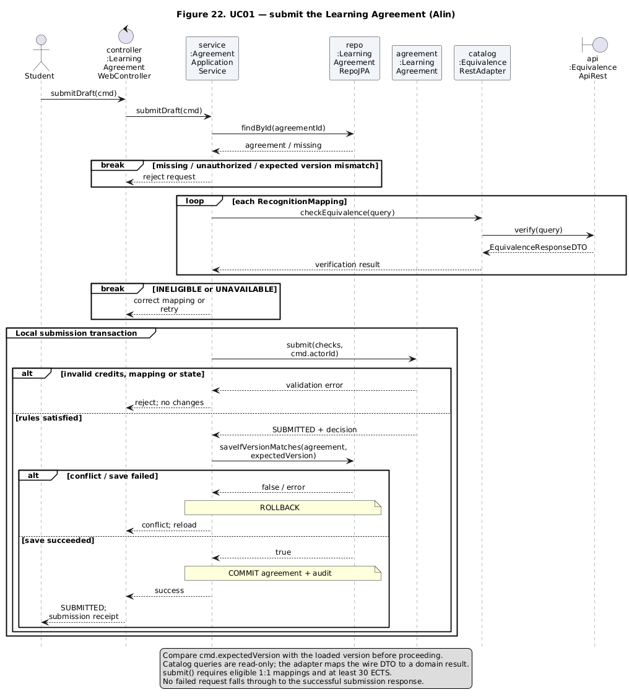
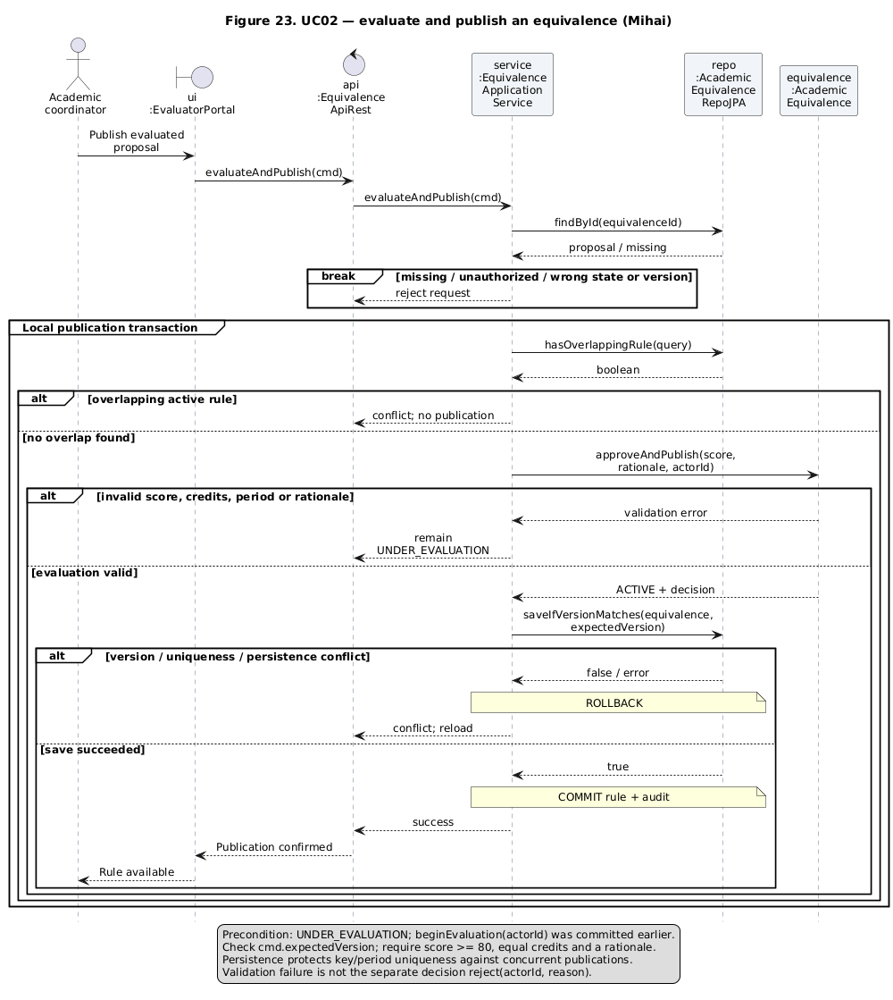
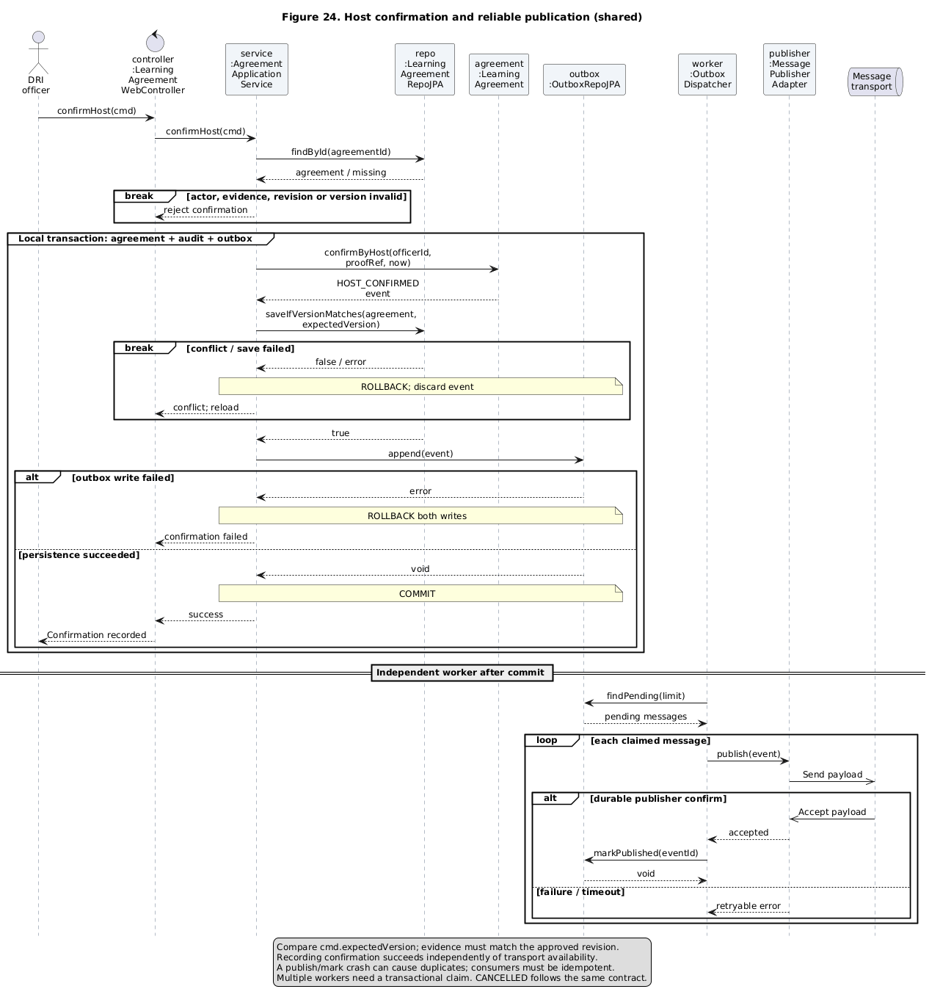
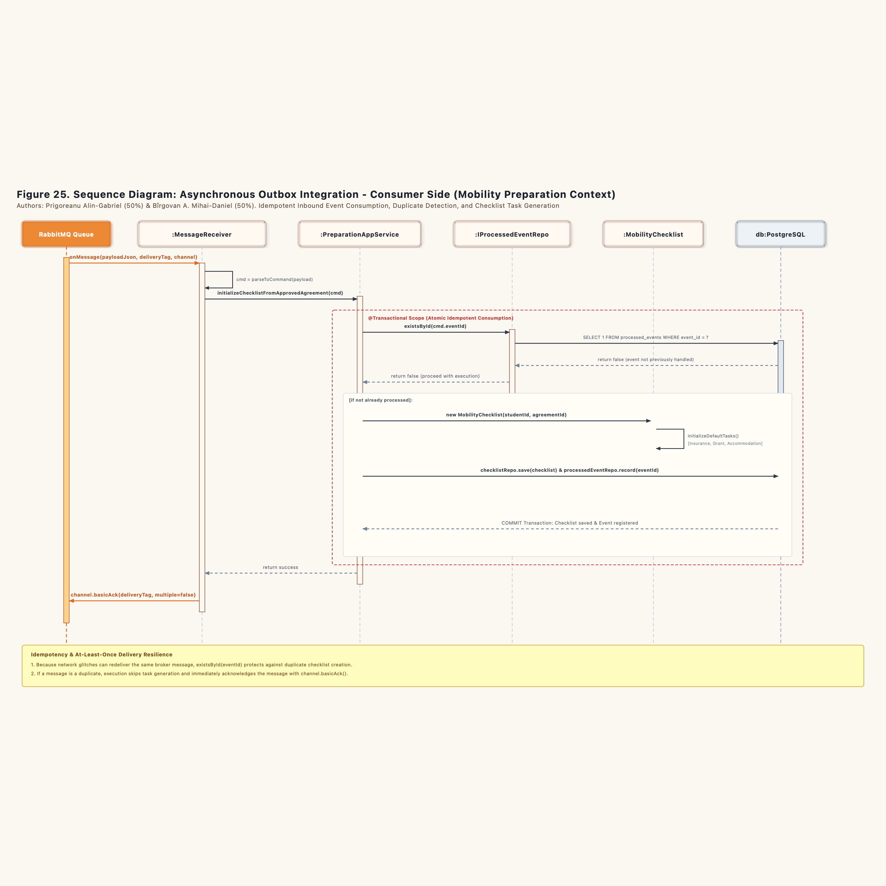

# Dynamic Integration Modeling: Sequence Diagram Specifications

This document details the dynamic collaboration between presentation controllers, application services, domain aggregates, repositories, and cross-boundary communication mechanisms across the Erasmus Mobility Platform.

---

### 6.2.1 Overview of Integration Flows

The system architecture employs two distinct integration paradigms to keep the three bounded contexts decoupled:

1. **Synchronous REST Integration (Figures 22 and 23):** Used for low-latency, read-only queries where immediate verification is required (checking course catalog equivalences during agreement drafting).
2. **Asynchronous Transactional Outbox Integration (Figures 24 and 25):** Used for business-critical state changes that trigger side effects across context boundaries (initializing student preparation checklists upon agreement approval).

---

### 6.2.2 UC01: Submit Learning Agreement (Figure 22)

UC01 starts with a persisted student-owned `DRAFT` and its expected version. The application loads the agreement, verifies ownership/state/version, then calls the read-only catalog adapter for every `RecognitionMapping`. `ELIGIBLE` results permit the aggregate to check 1:1 mapping, equal credits, no double counting, and the project minimum of 30 ECTS. `INELIGIBLE` or `UNAVAILABLE` stops before submission; unavailability is retryable, not academic rejection. On success, `submit(checks, actorId)` and `saveIfVersionMatches` run in one local transaction. Only a committed `SUBMITTED` state receives a success response. Version or persistence conflict rolls back and requires reload. This is the same success/failure flow as [UC01](use-cases/UC01-submit-learning-agreement.md) and `learning-agreement.feature`.

### 6.2.3 UC02: Evaluate and publish an equivalence (Figure 23)

UC02 begins with a persisted `UNDER_EVALUATION` proposal; `beginEvaluation(actorId)` is a prior, separate action. The service checks actor, state, expected version, and active-rule overlap, then calls `approveAndPublish(score, rationale, actorId)`. The aggregate requires the project score threshold of 80/100, equal credits, a valid period covering the mobility, and a rationale. A valid result and decision are saved as `ACTIVE` in one local transaction. Validation failures leave the proposal `UNDER_EVALUATION`; explicit rejection is a separate operation requiring a reason. Persistence must protect uniqueness under concurrent publication. These are the same outcomes as [UC02](use-cases/UC02-register-course-equivalence.md) and `equivalence-management.feature`.

### 6.2.4 Host confirmation and outbox publication (Figure 24)

The DRI records host evidence only after faculty approval and for the approved revision. The application commits `CONFIRMED_BY_HOST`, the decision, and the outbox event in one local transaction. The independent dispatcher publishes after commit and marks the message only after transport confirmation. A failed local save rolls back the confirmation; a publish timeout leaves the message retryable. Delivery can be repeated, so the receiver must be idempotent. Faculty approval alone does not create or complete a preparation checklist task.

### 6.2.5 Apply a confirmed-agreement event to the existing checklist (Figure 25)

The receiver records `eventId` and applies the event to the checklist already created for `MobilityId`. Event deduplication, checklist update, and save share one local transaction; the broker ACK follows commit. A missing checklist or persistence conflict rolls back the event record so the message can be retried. `HOST_CONFIRMED` completes only the existing academic task. A newer `CANCELLED` event cancels readiness, and an older confirmation cannot reactivate the dossier.
