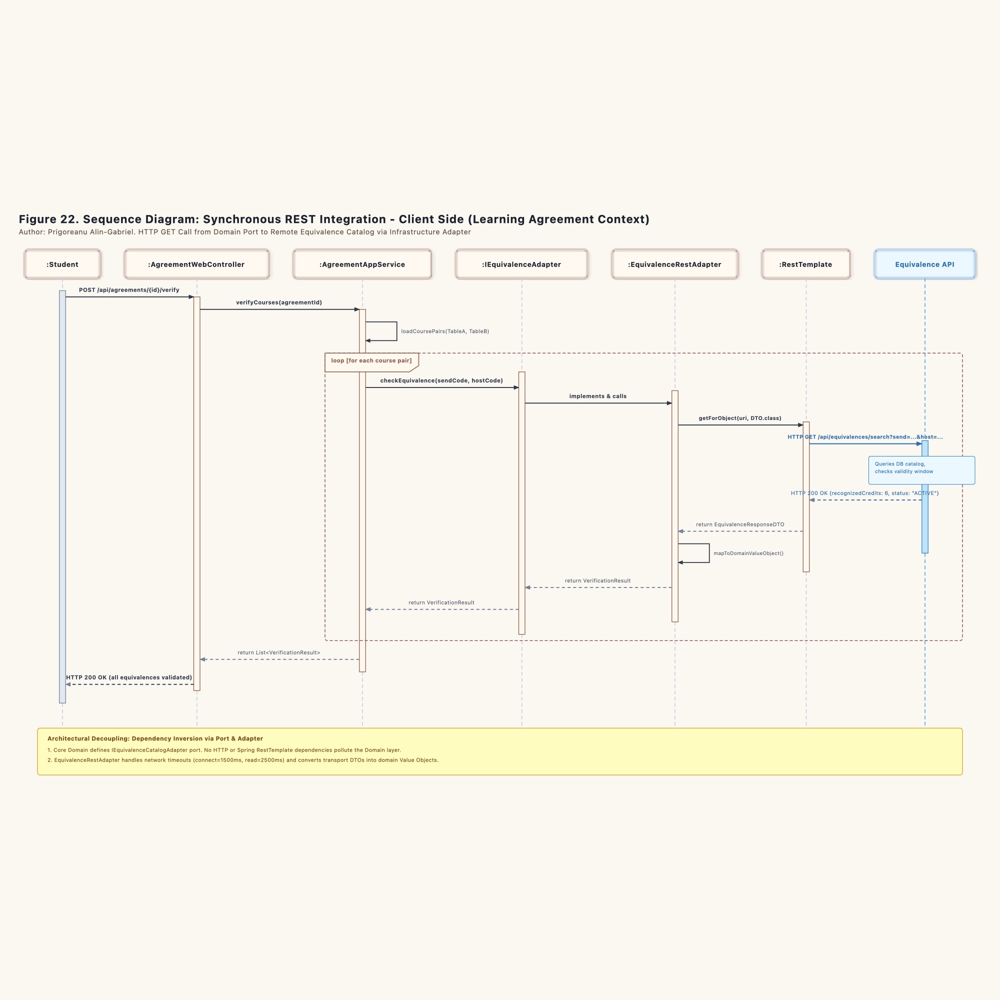
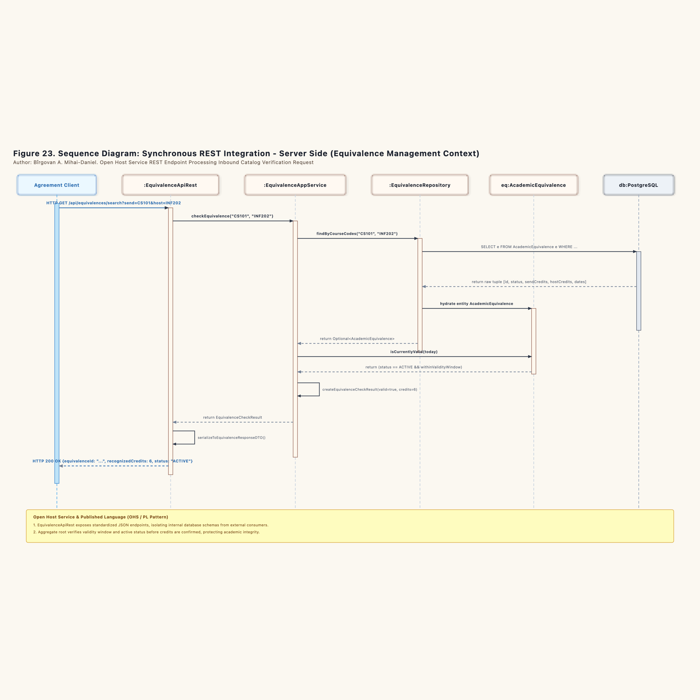
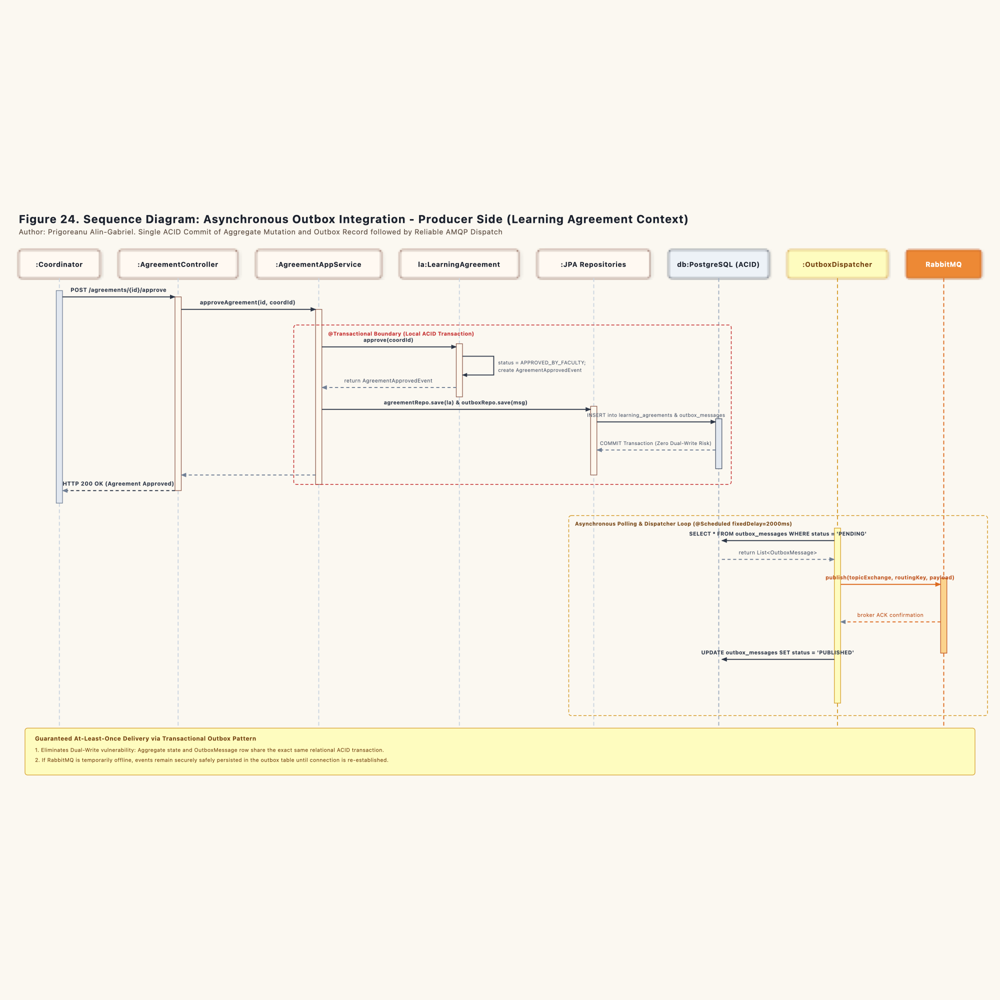
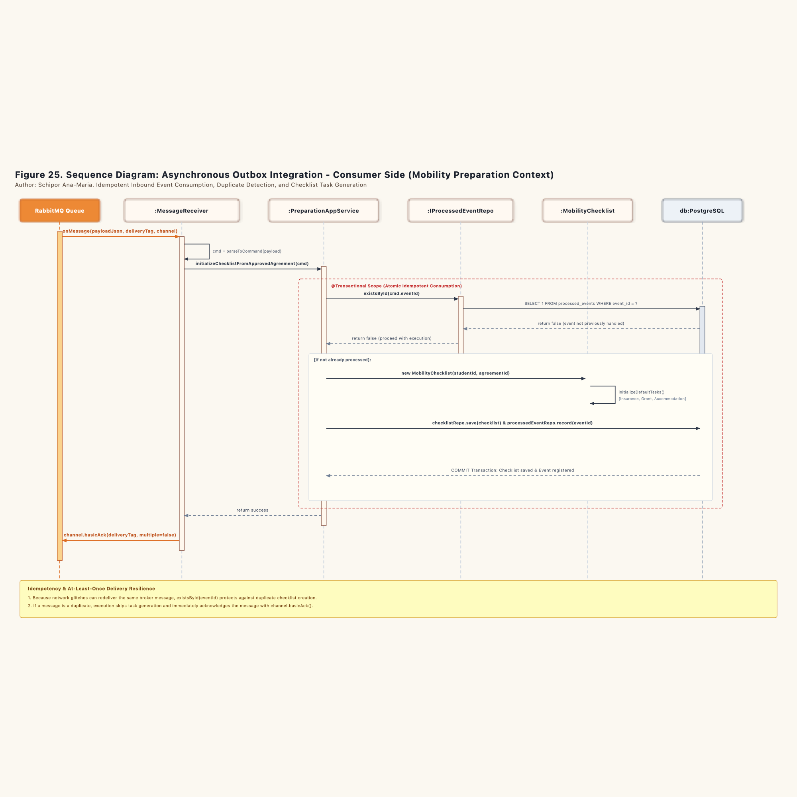

# Dynamic Integration Modeling: Sequence Diagram Specifications

This document details the dynamic collaboration between presentation controllers, application services, domain aggregates, repositories, and cross-boundary communication mechanisms across the Erasmus Mobility Platform.

---

## 1. Overview of Integration Flows

The system architecture employs two distinct integration paradigms to keep the three bounded contexts decoupled:

1. **Synchronous REST Integration (Figures 22 and 23):** Used for low-latency, read-only queries where immediate verification is required (checking course catalog equivalences during agreement drafting).
2. **Asynchronous Transactional Outbox Integration (Figures 24 and 25):** Used for business-critical state changes that trigger side effects across context boundaries (initializing student preparation checklists upon agreement approval).

---

## 2. Synchronous REST Integration (Client Side: Learning Agreement Context)

Figure 22 captures the execution path when a student triggers course verification in the Learning Agreement workspace.

### 2.1 Execution Sequence

1. **Trigger:** The `:Student` clicks "Verify Course Equivalences", issuing an HTTP `POST /api/agreements/{id}/verify` to `:AgreementWebController`.
2. **Application Orchestration:** The controller delegates to `AgreementApplicationService.verifyCourses(agreementId)`.
3. **Course Pair Extraction:** The application service reads the learning agreement from `agreementRepo`, extracting the paired course codes from Table A and Table B.
4. **Loop over Course Pairs:** For each pair, the service calls the domain port `IEquivalenceCatalogAdapter.checkEquivalence(sendCode, hostCode)`.
5. **Infrastructure Dispatch:** The port delegates to `EquivalenceRestAdapter`. The adapter formats the target URI and invokes Spring's `RestTemplate.getForObject(...)` with strict timeout settings (1500ms connect timeout, 2500ms read timeout).
6. **Network Request:** The adapter issues an HTTP GET call over the local network to the Equivalence Management API endpoint (`/api/equivalences/search`).
7. **Response Ingestion:** The remote API responds with HTTP 200 and a JSON payload. `RestTemplate` deserializes this JSON into an `EquivalenceResponseDTO`.
8. **Value Object Conversion:** The adapter maps the transport DTO into a domain Value Object `EquivalenceVerificationResult`. This protects the domain layer from transport-level schemas.
9. **Return to UI:** The application service collects all verification results and returns them to the controller. The controller responds to the student with an HTTP 200 status payload.

---

## 3. Synchronous REST Integration (Server Side: Equivalence Management Context)

Figure 23 models the internal processing within the Equivalence Management context when answering inbound verification calls.

### 3.1 Execution Sequence

1. **Inbound HTTP Call:** The remote client issues an HTTP GET to `/api/equivalences/search?send=CS101&host=INF202`.
2. **Open Host Controller:** `:EquivalenceApiRest` receives the request. As an Open Host Service, it verifies query parameter sanitization and calls `EquivalenceApplicationService.checkEquivalence("CS101", "INF202")`.
3. **Repository Query:** The service calls `AcademicEquivalenceRepository.findByCourseCodes(...)`.
4. **Database Execution:** `AcademicEquivalenceRepoJPA` runs a parameterized JPQL query against PostgreSQL (`SELECT e FROM AcademicEquivalence e WHERE ...`).
5. **Entity Hydration:** The repository loads the database tuple and reconstructs the `AcademicEquivalence` aggregate root.
6. **Domain Validation:** The service queries the aggregate using `isCurrentlyValid(today)`. The aggregate confirms that its internal status is `ACTIVE` and that the current date falls within its `ValidityWindow`.
7. **Published Language Mapping:** The service constructs an `EquivalenceCheckResult`. The REST controller maps this domain object into an `EquivalenceResponseDTO`.
8. **JSON Delivery:** The controller returns an HTTP 200 OK containing the standardized JSON payload.

---

## 4. Asynchronous Outbox Integration (Producer Side: Learning Agreement Context)

Figure 24 illustrates how the Learning Agreement context guarantees message delivery using the Transactional Outbox pattern, eliminating dual-write failure modes.

### 4.1 Execution Sequence

1. **Coordinator Sign-Off:** The `:Coordinator` submits an approval command (`POST /agreements/{id}/approve`) to `:AgreementController`.
2. **Transactional Entry:** The controller invokes `AgreementApplicationService.approveAgreement(id, coordId)`. Spring begins a local relational ACID transaction (`@Transactional`).
3. **Aggregate State Mutation:** The service loads the aggregate and invokes `la.approve(coordId)`. The aggregate validates that credit parity is satisfied, transitions status to `APPROVED_BY_FACULTY`, and generates a `LearningAgreementApprovedEvent`.
4. **Dual Write Avoidance:** Inside the same database transaction:
   * The updated aggregate is persisted via `agreementRepo.save(la)`.
   * The serialized domain event is saved to the outbox ledger via `outboxRepo.save(outboxMessage)` with status `PENDING`.
5. **Atomic Commit:** PostgreSQL commits both changes simultaneously. If either write fails, the entire transaction rolls back. Neither orphaned messages nor unsaved approvals can occur.
6. **HTTP Response:** The controller returns an immediate HTTP 200 confirmation to the coordinator.
7. **Scheduled Dispatcher Worker:** Operating in an independent background thread, `:OutboxDispatcher` triggers every 2000ms (`@Scheduled(fixedDelay = 2000)`).
8. **Outbox Polling:** The dispatcher executes `SELECT * FROM outbox_messages WHERE status = 'PENDING'` to retrieve unhandled messages.
9. **Broker Publication:** The dispatcher sends each message to RabbitMQ topic exchange `erasmus.events.topic` with routing key `agreement.approved`.
10. **Delivery Confirmation:** Upon receiving a broker ACK, the dispatcher executes `UPDATE outbox_messages SET status = 'PUBLISHED'` in the database.

---

## 5. Asynchronous Outbox Integration (Consumer Side: Mobility Preparation Context)

Figure 25 traces the inbound message handling within the Mobility Preparation context, highlighting the idempotent receiver design.

### 5.1 Execution Sequence

1. **AMQP Delivery:** The RabbitMQ queue (`mobility.preparation.agreement.approved`) delivers the message to `:AgreementApprovedMessageReceiver.onMessage(...)`.
2. **Command Translation:** The receiver parses the JSON body into an `InitializeChecklistCommand`, extracting `eventId`, `agreementId`, and `studentId`.
3. **Application Boundary:** The receiver calls `PreparationApplicationService.initializeChecklistFromApprovedAgreement(cmd)`. Spring opens a local database transaction.
4. **Idempotency Verification:** The service calls `processedEventRepo.existsById(cmd.eventId)`. This port queries the `processed_events` table in PostgreSQL.
5. **Duplicate Handling:**
   * **If the event ID exists:** The message was already processed in a previous attempt (such as during a network redelivery). The service logs a duplicate warning, skips aggregate generation, and commits the transaction cleanly.
   * **If the event ID does not exist:** The service proceeds with checklist generation.
6. **Aggregate Instantiation:** The service instantiates a new `MobilityChecklist` aggregate root. The aggregate runs `initializeDefaultTasks()`, generating standard student requirements (Health Insurance, Grant Agreement, Accommodation Proof).
7. **Atomic State Storage:** The service executes:
   * `checklistRepo.save(checklist)` to insert the checklist and child task rows.
   * `processedEventRepo.record(eventId)` to record the event ID in `processed_events`.
8. **Database Commit:** The transaction commits both the tasks and the event ledger atomically.
9. **Broker Acknowledgment:** The receiver confirms message receipt to the broker with `channel.basicAck(deliveryTag, false)`. RabbitMQ then removes the message from the queue.

